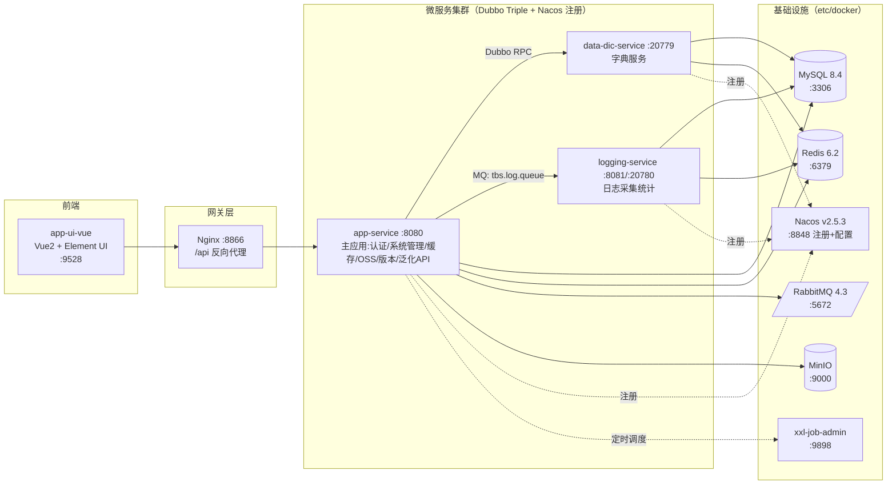

# Abstergo Solution

基于 **Spring Boot 2.7 + Dubbo 3 + Nacos** 的 Java 微服务快速开发平台：以「契约/实现分离、注解驱动装配、模块化 i18n、统一响应」为核心设计，提供从认证授权、系统管理、动态路由/表单、缓存、消息队列、任务调度、对象存储到操作日志的全栈能力。配套 Vue 2 + Element UI 管理前端，开箱即用。

```
后端 21 个 Maven 模块 + 1 个前端工程（app-ui-vue）
└── 3 个可运行服务：app-service（主应用）、data-dic-service（字典）、logging-service（日志）
```

## 目录

- [核心特性](#核心特性)
- [架构总览](#架构总览)
- [技术栈](#技术栈)
- [模块结构说明](#模块结构说明)
- [环境要求](#环境要求)
- [快速开始](#快速开始)
- [使用示例](#使用示例)
- [配置说明](#配置说明)
- [生产部署](#生产部署)
- [贡献指南](#贡献指南)
- [许可证](#许可证)

## 核心特性

- **注解驱动装配**：全部模块经 `@Enable*` 注解启用（如 `@EnableWebPack`、`@EnableTbsCache`），无 `spring.factories` 魔法；`AbstractAutoBeanRegister` 具备重复导入去重能力，按需组合、即插即用
- **契约/实现分离**：技术型模块一律拆分 `api`（契约，零实现依赖）与 `impl`（实现）两个 Maven 子模块，业务只依赖契约层；切换实现（如 Caffeine→Redis 多级缓存）零业务改动
- **统一响应与错误分级**：所有 HTTP 接口返回 `AjaxResult`（`{code, message, data}`），全局错误码语义（200/401/403/405/468/500/601/701）；异常按 `ErrorLevelEnum` 四级分级并走 i18n
- **国际化全链路**：后端 `AssertUtil.i18n(key)` 断言 + 模块化资源文件（`messages-{module}.properties`，中英双语自动注册）；前端 vue-i18n + `Accept-Language` 请求头联动
- **蓝绿部署验证**：`/public/gateway/version` 版本探针（构建信息 + 视图路由版本号），支撑前端动态路由缓存比对与流量切换验证
- **append-only 版本化配置**：动态视图路由/表单配置支持版本历史与一键回滚（版本表为唯一事实来源）
- **消息可靠性骨架**：厂商无关 MQ 抽象层（幂等三态、失败快照存储、档位延迟重投递、毒消息死信），RabbitMQ 实现开箱可用
- **SQL 观测**：p6spy 代理驱动全量 SQL 日志（慢 SQL 阈值 2s 检测）

## 架构总览



三个服务均以 Nacos 为注册中心（Dubbo Triple 协议）与配置中心；操作日志经 RabbitMQ 异步流入 logging-service 落库；xxl-job 集中驱动定时任务（树重建、日志刷盘、MQ 重投递等）。

## 技术栈

| 分类 | 技术 | 版本 |
|------|------|------|
| 语言/运行时 | Java | 11 |
| 核心框架 | Spring Boot | 2.7.18 |
| 微服务 | Spring Cloud / Spring Cloud Alibaba | 2021.0.4 / 2021.0.5.0 |
| RPC | Dubbo（Triple 协议） | 3.3.0 |
| 注册/配置中心 | Nacos | v2.5.3 |
| ORM | tk.mybatis + Spring Data JPA（DDL） | 4.2.3 / - |
| 数据库 | MySQL | 8.4（驱动 8.0.32） |
| SQL 观测 | p6spy | 3.8.2 |
| 缓存 | Redisson + Caffeine 多级缓存 | 3.52.0 |
| 消息队列 | RabbitMQ（amqp-client） | 4.3 |
| 任务调度 | XXL-Job | 2.5.0 |
| 对象存储 | MinIO | 8.5.7 |
| API 文档 | Knife4j（OpenAPI3） | 4.4.0 |
| 脚本引擎 | Spring Expression | - |
| 工具库 | Hutool / fastjson2 | 5.8.22 / 2.x |
| 前端 | Vue / Element UI / vue-i18n / ECharts | 2.6.10 / 2.15.14 / 8.x / 6.x |

## 模块结构说明

根 POM 聚合 21 个后端模块，按「基础层 → 契约层 → 实现层 → 应用层」组织依赖方向；每个模块均有独立 README（点击模块名查看详情）。

### 基础层（无业务语义的公共底座）

| 模块 | 职责 | 文档 |
|------|------|------|
| [common](common/README.md) | 断言/异常分级、i18n、UUID（雪花）、DataHolder、delegate 代理模式、分页、工具矩阵 | [README](common/README.md) |
| [async](async/README.md) | 线程池管理、事件广播、任务调度（时间轮/延迟队列）、本地锁 | [README](async/README.md) |
| [sql](sql/README.md) | QueryEngine SQL 构建引擎：注解驱动 QO → DSL → 多方言 SQL，自动填充、逻辑删除拦截 | [README](sql/README.md) |
| [web](web/README.md) | 令牌认证（Spring Security）、路径网关、统一响应 AjaxResult、请求上下文（Dubbo 传播）、泛化 API 调用 | [README](web/README.md) |

### 契约层（*-api，业务只依赖这些）

| 模块 | 契约 | 文档 |
|------|------|------|
| [mq-mod](mq-mod/README.md) | `mq-api`：厂商无关 MQ 契约（生产/消费编排/幂等三态/失败重投递） | [README](mq-mod/README.md) |
| [cache](cache/README.md) | `cache-api`：TTL 缓存、多级缓存、`@ExpireOn` 过期、`@CacheTransform` 序列化 | [README](cache/README.md) |
| [shared](shared/README.md) | `shared-api`/`shared-pojo`：全功能 Service 模板、24 个系统实体、27 个 Mapper、逻辑删除、校验框架 | [README](shared/README.md) |
| [tree-struct](tree-struct/README.md) | `tree-api`：内存多叉树 + 闭包表持久化契约 | [README](tree-struct/README.md) |
| [dynamic-view-route](dynamic-view-route/README.md) | `view-route-api`：动态视图路由（分组/版本/回滚）与动态表单配置 | [README](dynamic-view-route/README.md) |
| [system](system/README.md) | `system-api`：用户/角色组/公司/部门/版本/日志/泛化 API 等 20+ 服务契约 | [README](system/README.md) |
| [dic](dic/README.md) | `dic-api`：数据字典契约（枚举值/标签/比对） | [README](dic/README.md) |
| [logging](logging/README.md) | `logging-api`：日志记录/提取契约与报表 VO | [README](logging/README.md) |
| [script-engine](script-engine/README.md) | `script-api`：脚本引擎四层模型（引擎/编译器/执行器/结果），内置 SpEL | [README](script-engine/README.md) |
| [oss](oss/README.md) | `oss-api`：对象存储统一门面（OssClient/OssOperations） | [README](oss/README.md) |

### 实现层（可替换的具体实现）

| 模块 | 提供的实现 | 文档 |
|------|------|------|
| [redis-mod](redis-mod/README.md) | Redisson：分布式锁、缓存 L2、DataHolder、任务存储、MQ 幂等/失败存储 | [README](redis-mod/README.md) |
| [rabbitmq-mod](rabbitmq-mod/README.md) | RabbitMQ：收发实现、事件广播、日志通道（Java 序列化转换器） | [README](rabbitmq-mod/README.md) |
| [xxl-job-mod](xxl-job-mod/README.md) | XXL-Job 执行器装配、JSON 任务执行器、后台任务批量驱动、async 内核外部驱动 | [README](xxl-job-mod/README.md) |
| [open-api-starter](open-api-starter/README.md) | Knife4j 文档装配 + `@AjaxResponseType` 响应 Schema 定制 | [README](open-api-starter/README.md) |
| [updater](updater/README.md) | 自动更新库（多文件下载/部署脚本）+ `updater-gui` Swing 演示程序（统一文档） | [README](updater/README.md) |

> cache/system/tree-struct/dynamic-view-route 的实现子模块（`cache-impl`、`cache-caffeine-impl`、`default-system-impl`、`closure-list-impl`、`view-route-default-impl`）在各模块 README 内详述。

### 应用层（可运行产物）

| 模块 | 定位 | 文档 |
|------|------|------|
| [app](app/README.md) | 主应用运行包：16 注解装配全平台能力，25 个控制器，`app-service` :8080 | [README](app/README.md) |
| [app-ui-vue](app-ui-vue/README.md) | 管理前端：动态路由/表单、用户/角色/字典/缓存/OSS/日志/版本管理 | [README](app-ui-vue/README.md) |

### 启用注解速查

| 注解 | 模块 | 注解 | 模块 |
|------|------|------|------|
| `@EnableCommonPack` | common | `@EnableRabbitMq` | rabbitmq-mod |
| `@EnableTbsAsyncPack` | async | `@UseXxlJob` | xxl-job-mod |
| `@EnableTbsSql` + `@UseMysql` | sql | `@UseKnife4jPack` | open-api-starter |
| `@EnableWebPack` | web | `@EnableViewControl` | dynamic-view-route |
| `@EnableTbsCache` | cache | `@EnableSharedLibBean` | shared |
| `@EnableTbsMq` | mq-mod | `@UseClosureTableTree` | tree-struct |
| `@EnableTbsRedis` | redis-mod | `@EnableTbsOss` | oss |
| `@EnableScriptEngine` | script-engine | | |

聚合入口见 [app/README.md](app/README.md) 的「启动类与注解装配」。

## 环境要求

| 依赖 | 版本要求 | 说明 |
|------|----------|------|
| JDK | 11 | 后端编译运行 |
| Maven | 3.6+ | 后端构建 |
| Node.js | >= 8.9（推荐 12+） | 前端构建 |
| Docker / Docker Compose | 20.10+ | 一键启动依赖服务 |

## 快速开始

### 第一步：启动依赖服务

```bash
cd etc/docker
docker compose up -d
```

| 服务 | 端口 | 凭证 |
|------|------|------|
| MySQL 8.4 | 3306 | root / 123456 |
| Nacos v2.5.3（standalone） | 8848 | - |
| Redis 6.2 | 6379 | 密码 123456 |
| RabbitMQ 4.3 | 5672（管理台 15672） | admin / admin123 |
| MinIO | 9000（控制台 9001） | minioadmin / minioadmin |
| xxl-job-admin 2.5.0 | 9898 | accessToken 123456789 |
| Dubbo Admin 0.6.0 | 9600 | - |

### 第二步：初始化数据库

```bash
# Nacos 配置库（必须）
mysql -h127.0.0.1 -uroot -p123456 < etc/sql_file/nacos_config.sql
# XXL-Job 调度库（使用定时任务时必须）
mysql -h127.0.0.1 -uroot -p123456 < etc/sql_file/xxl-job/xxl_job_init.sql
```

业务库 `core_app` 由 JPA `ddl-auto: update` 在应用启动时自动建表；`etc/sql_file/app_system.sql` 提供完整表结构参考（含初始数据）。

### 第三步：构建并启动后端主应用

```bash
mvn clean package -pl app -am
java -jar app/target/app-1.0-SNAPSHOT.jar
```

主应用默认 `http://127.0.0.1:8080`。Nacos 不可用时仍可启动（配置导入带 `optional:` 前缀，回退本地 yml）。

可选：启动独立微服务（字典/日志，主应用不强依赖）：

```bash
mvn clean package -pl dic/dic-service -am && java -jar dic/dic-service/target/*.jar   # data-dic-service，Dubbo 20779
mvn clean package -pl logging/logging-impl -am && java -jar logging/logging-impl/target/*.jar  # logging-service，8081
```

### 第四步：启动前端

```bash
cd app-ui-vue
npm install
npm run dev          # http://localhost:9528，/api 自动代理到 127.0.0.1:8080
```

> 前端无 Mock 体系，需要后端主应用真实运行。

## 使用示例

### 1. 登录获取令牌

```bash
curl -X POST http://127.0.0.1:8080/public/user/login \
  -H 'Content-Type: application/json' \
  -d '{"userName":"admin","password":"123456"}'
```

响应（统一 `AjaxResult` 结构）：

```json
{
  "code": 200,
  "message": "操作成功",
  "data": { "token": "xxx", "expireTime": 1757000000000, "sessionId": "...", "tokenType": 1 }
}
```

### 2. 携带令牌访问私有接口

```bash
curl http://127.0.0.1:8080/private/user/info -H 'Authorization: <token>'
```

令牌过期（业务码 405）时前端会静默调 `GET /public/user/refresh` 续期；刷新失败（468）整页重登。

### 3. 版本探针（蓝绿部署验证）

```bash
curl http://127.0.0.1:8080/public/gateway/version
# { "version": "1.0-SNAPSHOT", "buildTime": "...", "instancePort": 8080, "viewVersion": 12 }
```

### 4. API 文档

- Swagger（Knife4j）：`http://127.0.0.1:8080/doc.html`
- xxl-job 控制台：`http://127.0.0.1:9898/xxl-job-admin`
- Nacos 控制台：`http://127.0.0.1:8848/nacos`

### 5. 前端

浏览器打开 `http://localhost:9528` → 登录页 → 登录后进入管理后台（用户/角色/字典/缓存/OSS/日志/版本/路由管理等模块）。

## 配置说明

### 环境变量

| 变量 | 默认值 | 说明 |
|------|--------|------|
| `NACOS_ADDRESS` | `127.0.0.1:8848` | Nacos 注册与配置中心 |
| `DB_HOST` / `DB_PORT` / `DB_NAME` | `127.0.0.1` / `3306` / `core_app` | 数据库 |
| `DB_USERNAME` / `DB_PASSWORD` | `root` / `123456789` | 数据库凭证 |
| `REDIS_HOST` / `REDIS_PORT` / `REDIS_PASSWORD` | `127.0.0.1` / `6379` / `123456` | Redis |
| `RABBITMQ_HOST` / `RABBITMQ_PORT` | `127.0.0.1` / `5672` | RabbitMQ |
| `RABBITMQ_USERNAME` / `RABBITMQ_PASSWORD` | `admin` / `admin123` | RabbitMQ 凭证 |
| `XXL_JOB_ADMIN_ADDRESS` / `XXL_JOB_ACCESS_TOKEN` | `http://127.0.0.1:9898/xxl-job-admin` / `123456789` | 调度中心 |
| `OSS_ENABLE` / `OSS_TYPE` | `false` / `minio` | 对象存储开关与实现类型 |
| `OSS_ENDPOINT` / `OSS_ACCESS_KEY_ID` / `OSS_ACCESS_KEY_SECRET` | `http://127.0.0.1:9000` / `minioadmin` / `minioadmin` | MinIO 连接 |
| `APP_GATEWAY_VERSION` | 构建版本 | 版本标识覆盖（蓝绿验证） |

### 配置分层

优先级：**Nacos 远程配置 > 本地 profile（`application-{tbs,db,redis,mq}.yml`）**。主应用经 `spring.config.import` 从 Nacos 拉取 `RABBITMQ.yml`/`CoreAppDb.yml`/`REDIS.yml`/`app-service.yml`（均带 `optional:` 前缀与 `refreshEnabled`）；`.env` 文件经 spring-dotenv 支持本地环境变量兜底。

平台 `tbs.*` 配置（`tbs.web`/`tbs.cache`/`tbs.system` 等 20+ 前缀）的完整清单见 [app/README.md](app/README.md)「配置体系」与各模块 README「配置参考」。

## 生产部署

1. **前端**：`npm run build:prod` → `dist/`；Nginx 参考配置见 `app-ui-vue/nginx.conf`（监听 8866，`/api/` rewrite 后代理后端，history 模式回落 `index.html`，静态资源 7 天缓存）
2. **后端**：可执行 jar + 环境变量注入（或将配置迁入 Nacos）；建议 `ddl-auto` 改为 `validate`，用迁移脚本管理表结构
3. **拓扑**：Nginx → app-service（可多实例）；dic/logging 服务按需横向扩容；全部服务注册到生产 Nacos
4. **调度**：xxl-job 控制台注册执行器（`app-name: mainSystemApplication`），配置 `department_tree_rebuild`、`flushLogData`、`runningBackGroundJobHandler`（含 MQ 重投递）等任务

详细规范见 [docs/guideline/06-部署与运维规范.md](docs/guideline/06-部署与运维规范.md) 与 [app-ui-vue/DEPLOYMENT.md](app-ui-vue/DEPLOYMENT.md)。

## 贡献指南

开发规范总纲见 [DEVELOPMENT_GUIDELINE.md](DEVELOPMENT_GUIDELINE.md)（含 7 个分册：项目总览/中间件规范/功能模块规范/接口设计/前端规范/部署运维/Code Review 清单）。**全局铁律摘要**：

1. 后端代码统一 **Java**（项目已全面 Java 化，不再使用 Kotlin）
2. 类与函数使用块注释（`@param`/`@return`），**禁止行尾注释**
3. 断言必须走 `AssertUtil.isTrue(条件).i18n("key").params(...).errorLevel(...).throwIt()`，禁止 `throw new FormattedRuntimeException`
4. 所有用户可见文案走 i18n 资源 key（后端）/`$t()`（前端），禁止硬编码
5. 配置统一 `@ConfigurationProperties` Property 类（提供 `tbs.{module}.enable` 总开关），禁止散落 `@Value`
6. Controller 只做接入与参数组装，业务校验全部在 Service 层
7. 技术型模块必须拆分 `api`/`impl` 子模块
8. 接口统一返回 `AjaxResult`；`/public/**` 免认证、`/private/**` 必须认证
9. 公共契约方法改造：新增方法 + 旧方法标 `@Deprecated`（渐进迁移），禁止直接改签名
10. `@Cacheable` 等 cacheNames 必须引用模块 `CacheNamesConstants` 常量，禁止魔法值字符串

**文档维护约定**：修改模块行为时同步更新该模块 README（本仓库 22 份模块 README 均基于源码核实维护）；合并前必须通过 [07-Code Review 检查清单](docs/guideline/07-Code-Review检查清单.md)。

## 许可证

[Apache License 2.0](LICENSE)

---

**维护人**: abstergo　**最后更新**: 2026-09
