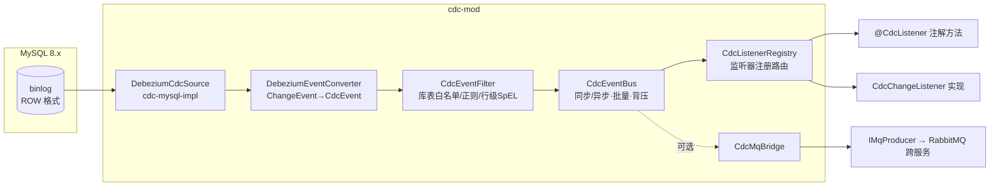

# cdc-mod 数据库变更数据捕获（CDC）模块

在现有微服务平台中新增的**纯后端能力模块**：实时监听数据库的增、删、改操作（含外部系统产生的变更），
并在代码内部以统一格式的消息事件触发相应处理逻辑。本模块无用户界面。

---

## 1. 概述与能力

| 能力 | 说明 |
|------|------|
| 变更捕获 | 实时读取数据库日志流（MySQL binlog），捕获 INSERT / UPDATE / DELETE；覆盖包括外部系统在内的所有变更来源。查询（READ）因日志流机制限制无法捕获，仅在枚举中预留 |
| 事件生成 | 每次变更转换为统一结构 `CdcEvent`：变更类型、变更前/后数据、时间戳、库标识、表名、主键、事务信息、日志位点、`eventId` |
| 消息发布 | 默认进程内事件分发（同步/异步可配），可选桥接至消息队列实现跨服务分发 |
| 订阅消费 | 注解式监听（`@CdcListener`，按库表/变更类型路由）与编程式接口（`CdcChangeListener`）两种风格并存 |
| 过滤控制 | 库/表白名单与排除、表级正则匹配、行级 SpEL 条件过滤 |
| 批量与频率控制 | 队列容量、批量大小、刷新间隔、队列满背压策略 |
| 错误处理 | 监听器失败重试次数/延迟、最终失败 skip/dead-letter 分级 |
| 多数据库扩展 | 数据库无关的 `CdcSource` 抽象；新增 PostgreSQL/MongoDB 只需新增实现子模块，契约层与消费端零改动 |
| 断点续传 | 消费位点持久化（`FileOffsetBackingStore`），重启后从上次位点继续，至少一次语义 |

### 技术栈
- Java 21 / Spring Boot 3.3.5
- binlog 解析：Debezium Embedded Engine 3.x（`debezium-api` + `debezium-embedded` + `debezium-connector-mysql`）
- 位点持久化：Debezium `FileOffsetBackingStore`（文件存储，零额外中间件依赖）
- 进程内分发：自建轻量事件总线（同步直发 / 异步有界队列批量，队列满背压）
- MQ 桥接：复用 `mq-api` 的 `IMqProducer` 契约（RabbitMQ 实现开箱可用）
- 行级过滤：Spring Expression（SpEL），与 `script-engine` 模块技术选型一致

---

## 2. 架构与数据流



**数据流**：binlog 流 → Debezium Engine（独立单线程、位点文件持久化）→ `ChangeEvent` 转 `CdcEvent`
→ 过滤链 → 事件总线（有界队列，批量/逐条可配）→ 并行分发至匹配的进程内监听器 + 可选 MQ 路由
（routingKey 模板 `cdc.{database}.{table}.{changeType}`）。

### 模块拆分（契约/实现分离）
```
cdc-mod/
├── cdc-api          # 契约层，仅依赖 common：CdcEvent/CdcSource/监听契约/@EnableTbsCdc
├── cdc-impl         # 通用运行时，依赖 cdc-api + mq-api + async：配置/总线/路由/过滤/MQ桥接/生命周期/i18n
└── cdc-mysql-impl   # MySQL 实现，依赖 cdc-impl + Debezium：DebeziumCdcSource/转换器/配置工厂/@EnableCdcMysql
```

---

## 3. 快速开始

### 3.1 装配
主应用仅依赖 `cdc-mysql-impl`，在启动类叠加两个注解即可（`@EnableCdcMysql` 已同时扫描 `com.tbs.cdc.mysql` 与 `com.tbs.cdc`，一步装配全部包）：

```java
@EnableTbsCdc
@EnableCdcMysql
@SpringBootApplication(scanBasePackages = {"com.tbs.app"})
public class AppApplication { /* ... */ }
```

### 3.2 配置（`application-tbs.yml` 片段）
```yaml
tbs:
  cdc:
    enable: ${CDC_ENABLE:false}        # 总开关，false 时零 Bean、零线程
    source-type: mysql
    payload-mode: changed-only         # full / changed-only / key-only
    mysql:
      hostname: ${CDC_DB_HOST:127.0.0.1}
      port: ${CDC_DB_PORT:3306}
      username: ${CDC_DB_USERNAME:cdc_user}   # 仅 REPLICATION SLAVE/CLIENT 最小权限账号
      password: ${CDC_DB_PASSWORD:}
      server-name: tbs_cdc                    # 全局唯一，作 topic 前缀/源标识
      server-id: ${CDC_SERVER_ID:184001}       # 高危：唯一且落在 [2,4294967294]
      database-include-list: core_app
      table-include-list: ""                  # 逗号分隔 db.table，留空表示库内全表
      offset-storage-file: data/cdc-offsets.dat
      snapshot-mode: never                    # never 仅增量；initial 全量快照+增量
      heartbeat-interval-ms: 5000
    filter:
      include-databases: []
      exclude-databases: []
      include-table-patterns: []              # 表级正则白名单
      exclude-table-patterns: []
      row-conditions:                         # 行级 SpEL，key=db.table，false 则丢弃
        "[core_app.sys_user]": "#afterData['status'] != 'DELETED'"
    dispatch:
      mode: in-process                        # in-process / mq / both
      in-process-mode: async                  # sync / async
      mq:
        exchange: tbs.cdc
        routing-pattern: "cdc.{database}.{table}.{changeType}"
    batch:
      queue-capacity: 10000
      batch-size: 200
      flush-interval-ms: 500
      on-full: block                          # block / drop-oldest
    error:
      retry-times: 3
      retry-delay-ms: 1000
      on-fail: skip                           # skip / dead-letter
```

### 3.3 监听（两种风格）
注解式：
```java
@Component
public class MyListener {
    @CdcListener(tables = {"sys_user"}, types = {CdcChangeType.CREATE, CdcChangeType.UPDATE})
    public void onChange(CdcEvent event) {
        // 至少一次投递，须按 event.getEventId() 幂等
    }
}
```

编程式：
```java
@Component
public class MyChangeListener implements CdcChangeListener {
    @Override
    public CdcSubscription getSubscription() {
        return CdcSubscription.builder()
            .tablePatterns(Set.of("sys_role"))
            .changeTypes(EnumSet.of(CdcChangeType.DELETE))
            .async(true)
            .build();
    }
    @Override
    public void onCdcEvent(CdcEvent event) { /* ... */ }
}
```

---

## 4. 配置项参考

### CdcProperty（`tbs.cdc.*`）
| 配置 | 默认 | 说明 |
|------|------|------|
| `enable` | false | 模块总开关 |
| `source-type` | mysql | 捕获源类型标识 |
| `payload-mode` | changed-only | 载荷裁剪：`full` 前后完整行；`changed-only` UPDATE 仅差异列；`key-only` 仅主键 |
| `mysql.*` | 见上 | 连接信息、`server-name`、`server-id`、include 列表、位点文件、快照模式、心跳 |
| `filter.*` | 空 | 库/表白名单与排除、行级 SpEL 条件 |
| `dispatch.mode` | in-process | `in-process`/`mq`/`both` |
| `dispatch.in-process-mode` | async | 进程内 `sync`/`async` |
| `dispatch.mq.*` | `tbs.cdc` / 模板 | MQ 交换机与路由键模板 |
| `batch.*` | 10000/200/500/block | 队列容量、批量、刷新间隔、背压策略 |
| `error.*` | 3/1000/skip | 重试次数、延迟、最终失败策略 |

---

## 5. 运维前提（务必人工配合）

1. **MySQL 开启 binlog**：`log_bin=ON`、`binlog_format=ROW`、`binlog_row_image=FULL`。
2. **CDC 专用最小权限账号**：仅 `REPLICATION SLAVE` + `REPLICATION CLIENT`，不授业务库读写权限。
   初始化脚本见 `etc/sql_file/cdc_user_init.sql`。`snapshot.mode=initial` 才需额外 SELECT 等权限。
3. **唯一 `server-id`**：每个 CDC 实例配置唯一 `server-id`（不与 MySQL 集群其他复制节点冲突）。
   **冲突会导致复制流被 MySQL 顶掉，属高危配置项。** 启动期已断言非空与合法范围 `[2,4294967294]`。
4. **位点文件**：默认 `data/cdc-offsets.dat`（运行目录）。生产环境建议挂载持久卷。
   删除该文件且 `snapshot.mode=initial` 会触发全量快照重新消费；`never` 模式下删除位点文件将从当前 binlog 起点增量。
5. **结构历史文件**：与位点文件同目录，自动派生为 `{offset去后缀}-dbhistory.dat`。

---

## 6. 可靠性与语义

- **至少一次投递**：位点在事件成功进入分发管道（`markProcessed`）后随批次提交；重启断点续传可能产生重复事件，
  **消费端必须按 `eventId` 幂等去重**（进程内监听器文档约定幂等责任；MQ 侧复用 `mq-api` 幂等/失败快照骨架）。
- **背压**：异步模式使用有界队列，队列满按 `on-full` 策略 `block`（阻塞捕获线程保证不丢）或
  `drop-oldest`（丢最旧并告警，保证不阻塞、可能丢）。
- **错误分级**：捕获层连接类异常由 Debezium 引擎内部重连重试；分发层监听器异常按 `retry-times`/`retry-delay`
  重试，仍失败按 `on-fail`：`skip` 记 ERROR 日志，`dead-letter` 记录含 `eventId` 与完整载荷的死信快照。
  所有异常经 `AssertUtil` + i18n 落日志，禁止吞异常。
- **优雅停止**：停止遵循“先停捕获源、再刷分发队列、后关监听线程池”的顺序，位点安全。
- **异步不阻塞**：`async` 监听走独立线程池，慢监听不阻塞捕获链路。

---

## 7. 扩展新数据库

1. 新建 `cdc-{db}-impl` 子模块，parent 为 `cdc-mod`，依赖 `cdc-impl` + 对应 Debezium connector。
2. 实现 `CdcSource`（如 `DebeziumCdcSource` 的同构封装），将连接器事件转为统一 `CdcEvent`。
3. 复用 `cdc-impl` 的事件总线、过滤链、MQ 桥接与 `CdcRuntimeManager`（按类型装配 `CdcSource` Bean）。
4. 提供 `@EnableCdc{Db}` + `Cdc{Db}AutoRegister`（参考 `RabbitMqAutoRegister` 一步装配实现与运行时包）。

> Debezium 的通用 `ChangeEvent` API 使 PostgreSQL（pgoutput）/MongoDB（Change Stream）扩展只需换 connector + 新增子模块。

---

## 8. 已知限制与待验证

- **Debezium 键名版本对齐**：`DebeziumConfigFactory` 按 Debezium **3.0.x** 键名配置（`topic.prefix`、
  `schema.history.internal` 等）。升级 Debezium 大版本时需对齐键名；`SCHEMA_HISTORY_CLASS`
  (`io.debezium.relational.history.FileDatabaseHistory`) 在部分新版本可能改名为 `io.debezium.schema.*`，需按实际依赖版本核对。
- **编译/联调验证**：本模块产出代码仅做静态自查，`mvn compile` 与真实 binlog 联调**待人工验证**。
- **行级过滤表达式**：使用只读 `SimpleEvaluationContext`，表达式仅可访问数据变量，禁止类型引用与构造。
