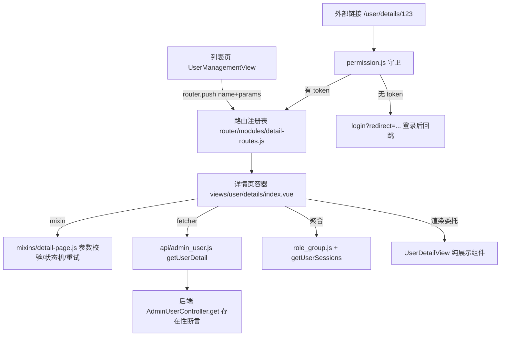

# 基于 URL 参数的详情页跳转架构设计文档

> 适用范围：`app-ui-vue` 所有基于 URL 动态参数的详情页（如 `/user/details/:userId`）。
> 本文描述「集中路由注册表 + 通用详情页 mixin + 容器/展示分层」的详情页架构，
> 包含已落地的用户详情页案例、完整跳转链路与新详情页低成本接入路径。
> 约束基线：Vue 2.6 + Vue Router 3.x（history 模式）+ Element UI 2.15（唯一 UI 框架）、
> 文案统一 `$t()`（中英两份同步）、HTTP 统一走 `@/utils/request`。

## 1. 背景与目标

详情页（用户详情、订单详情、配置详情等）此前无统一接入模式，若各自实现路由注册、参数校验与加载状态，会带来：

1. **路由登记分散**：动态路由来自后端菜单（`getRoutes()`），登录后才能加载，直接输入 URL 或刷新会被 `* → /404` 兜底吞掉。
2. **重复实现**：参数校验、加载/错误状态机、路由参数变化重载等逻辑每个页面重复写。
3. **异常处理缺失**：无效 ID（非数字、不存在）没有统一兜底提示与跳转。

**架构目标**：

- 新增详情页 = 注册表加一条路由 + 建页面容器（复用 mixin）+ 封装 API + 写展示组件，**不触碰路由守卫与动态路由机制**。
- 支持三类入口：列表页跳转、外部链接直达（未登录自动回跳）、同组件不同参数复用（自动重载）。
- 无效参数双层兜底：前端正则校验 + 后端存在性断言（`AssertUtil.i18n`）。

## 2. 总体架构与分层



**分层职责**：

| 层 | 位置 | 职责 |
|----|------|------|
| 路由注册表 | `src/router/modules/detail-routes.js` | 所有详情页路由集中登记，合并进 `constantRoutes`（静态路由），保证刷新/直达不被 404 兜底；`meta.activeMenu` 指回列表菜单路径 |
| 通用 mixin | `src/mixins/detail-page.js` | 参数正则校验（非法提示并跳回列表）、`created` + `watch $route.params` 双触发加载、`detailData/detailLoading/detailError` 状态机、`retryFetch` 重试 |
| 页面容器 | `src/views/{biz}/details/index.vue` | 声明 `detailConfig`（paramName/idPattern/fetcher/fallbackRoute），接入 mixin；数据编排（关联数据并行拉取、惰性加载）；事件处理 |
| 展示组件 | `src/components/{Biz}DetailView/` | 纯渲染（卡片/表格/标签），零数据逻辑，props 进 events 出 |
| API 层 | `src/api/{biz}.js` | get-by-id 接口封装（JSDoc 齐全），统一走 `@/utils/request` |
| 后端接口 | `controller/privates/{Biz}Controller` | 覆写 `get` 增加存在性断言（`AssertUtil.i18n`），返回统一 `AjaxResult` |
| 路由守卫（不变式） | `src/permission.js`、`src/router/index.js` | 登录态校验、动态路由加载、`?redirect=` 回跳；视为黑盒，详情页架构不得改动 |

## 3. 已落地代码结构（用户详情页案例）

```
app-ui-vue/src/
├── router/
│   ├── index.js                      # [MODIFY] constantRoutes 中 spread 合并 detailRoutes
│   └── modules/
│       └── detail-routes.js          # [NEW] 详情页路由集中注册表
├── mixins/
│   └── detail-page.js                # [NEW] 通用详情页 mixin
├── api/
│   └── admin_user.js                 # [MODIFY] 新增 getUserDetail(userId)
├── views/user/
│   └── details/
│       └── index.vue                 # [NEW] 用户详情页容器（数据编排）
├── components/
│   ├── UserDetailView/
│   │   └── index.vue                 # [NEW] 纯展示组件（基本信息/角色组/会话/令牌）
│   └── UserManagementView/
│       └── index.vue                 # [MODIFY] actions 插槽新增"详情"按钮
└── i18n/
    ├── zh.js                         # [MODIFY] detail/userDetail 命名空间
    └── en.js                         # [MODIFY] 同步英文

app/src/main/java/com/tbs/app/controller/privates/
└── AdminUserController.java          # [MODIFY] 覆写 get()：用户不存在抛 i18n 业务异常
```

## 4. 路由配置方案

```javascript
/* src/router/modules/detail-routes.js */
export const detailRoutes = [
  {
    path: '/user/details/:userId',
    component: Layout,
    hidden: true,
    children: [
      {
        path: '',
        name: 'UserDetails',
        component: () => import('@/views/user/details/index.vue'),
        meta: {
          title: i18n.t('userDetail.title'),
          activeMenu: '/common/user',   /* 侧边栏高亮指回用户列表菜单 */
          breadcrumb: false
        }
      }
    ]
  }
]
```

要点：

1. **静态路由而非后端菜单登记**：详情页不进侧边栏（`hidden: true`），无菜单权限记录需求；挂在 `constantRoutes` 保证刷新与外部直达不被 `* → /404` 吞掉。访问权限由守卫（登录态/`meta.roles`）与后端接口权限（`@PreAuthorize`）双重保障。
2. **name + params 跳转**：列表页 `$router.push({ name: 'UserDetails', params: { userId: row.id }})`，与 URL 形态解耦。
3. **参数名约定**：路由参数名与页面 `detailConfig.paramName` 一致，mixin 据此读取。

## 5. 参数校验与异常处理

**双层兜底**：

| 场景 | 处理层 | 行为 |
|------|--------|------|
| 非数字 userId（`/user/details/abc`） | 前端 mixin（`idPattern` 正则） | `$message.error($t('detail.invalidId'))` + `$router.replace(fallbackRoute)` 跳回列表 |
| 数字但用户不存在/已删除 | 后端 Controller（`AssertUtil.isTrue(user == null).i18n('user.not.exists')`） | 返回错误 `AjaxResult`，`request.js` 拦截器弹出后端 i18n 消息；mixin 进入错误态展示重试按钮 |
| 未登录直达 | 前端守卫（既有逻辑） | 跳 `/login?redirect=/user/details/123`，登录成功后回跳 |
| 同组件不同参数复用（userId 1 → 2） | 前端 mixin（`watch $route.params`） | 自动重新拉取数据 |

后端覆写示例：

```java
@Override
public AjaxResult get(@Parameter(name = "id", description = "用户ID", required = true) @PathVariable Long id) {
    var user = getService().queryById(id);
    AssertUtil.isTrue(user == null).i18n("user.not.exists").errorLevel(ErrorLevelEnum.USER_INPUT_ERROR)
        .throwIt();
    return successResult(user);
}
```

## 6. 数据获取与状态管理

- **基本信息**：mixin 经 `detailConfig.fetcher` 拉取，成功后触发容器 `afterDetailLoaded` 钩子。
- **关联数据**：容器在钩子中 `Promise.all` 并行拉取角色组（`getUserRoleGroupVOList`）与登录会话（`getUserSessions`），失败静默降级为空列表（拦截器已弹错误提示）。
- **惰性加载**：会话令牌明细（`getTokensBySessionId`）在展开会话行时才请求，避免 N+1。
- **状态归属**：详情数据为组件局部状态（data），不入 Vuex（无跨页共享需求，符合 05 分册 5.7.7）。

## 7. 新增详情页接入流程（Checklist）

以「订单详情页 `/order/details/:orderId`」为例：

1. **API 封装**：`src/api/order.js` 新增 `getOrderDetail(orderId)`（JSDoc 齐全，模板字符串路径）。
2. **后端接口**：Controller 覆写 `get` 增加存在性断言（i18n key 中英两份，无现成 key 时同步新增 `messages-system.properties` 两份资源）。
3. **路由注册**：`src/router/modules/detail-routes.js` 追加一条路由（path `/order/details/:orderId`、name `OrderDetails`、`meta.activeMenu` 指回订单列表菜单）。
4. **页面容器**：新建 `src/views/order/details/index.vue`，声明 `detailConfig`（paramName/idPattern/fetcher/fallbackRoute），`mixins: [detailPageMixin]`，在 `afterDetailLoaded` 编排关联数据。
5. **展示组件**：新建 `src/components/OrderDetailView/index.vue` 纯渲染组件（props 进 events 出）。
6. **列表入口**：列表页 actions 插槽加"详情"按钮，`$router.push({ name: 'OrderDetails', params: { orderId: row.id }})`。
7. **i18n**：`zh.js`/`en.js` 同步新增 `orderDetail` 命名空间文案。
8. **自检**：`npm run lint` 通过；对照 07 检查清单前端部分逐项自检。

**验收场景**：列表跳转正常渲染；浏览器直达 URL（含未登录回跳）；非法 ID 有提示并跳回列表；不存在的 ID 显示后端 i18n 错误与重试按钮。

## 8. 关键约定

1. 路由 name 唯一，命名为 `{Biz}Details`；参数名命名为 `{biz}Id`。
2. `fallbackRoute` 指向该业务列表页路径；`activeMenu` 指向列表菜单路径。
3. 展示组件不 import API、不感知路由；容器不写渲染细节。
4. 新代码禁留 `console.log`；禁用 Vue 3 语法；文案禁硬编码。
5. 详情页路由不依赖后端菜单数据，勿将 `:param` 路径登记进后端菜单（`require.context` 映射不支持参数匹配语义）。

## 变更记录

| 版本 | 时间 | 说明 |
|------|------|------|
| 1.0.0 | 2026-09 | 初版：架构落地，用户详情页案例接入 |
