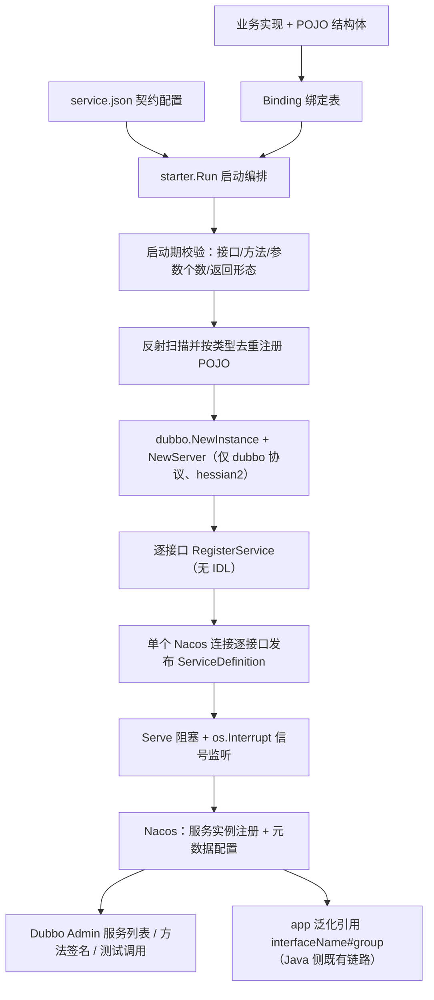

# Go 轻量 Dubbo 提供者：实现与接入指南

> 本文按 `dubbo-go-starter`（可复用库）与 `dubbo-db-demo`（示例服务）的**当前实现**编写，与源码逐项核对。
> 定位、开发步骤、类型口径与验收方式以此文为准；库的字段级说明另见 [dubbo-go-starter/README.md](../dubbo-go-starter/README.md)。

---

## 一、定位与边界

平台的主体是 Java 21 + Spring Boot 3.3.5 的 Maven 多模块工程，Dubbo 服务由 `@DubboService` 发布、app 主应用经 `@DubboReference` / 泛化链路消费。对于「几个简单方法、却要新建一个 Spring Boot 工程」的场景，接入体量过重，因此引入 **Go 轻量提供者**：

- 单二进制交付（`go build` 产出 exe），**不引入容器、编排、部署脚本**；
- 两个独立 Go module，**不纳入根 `pom.xml` 的 modules**，与 Java 工程零耦合；
- 服务按标准 Dubbo 语义注册到同一 Nacos，Dubbo Admin 与 app 泛化链路均能识别（**零 jar、无需 Java 接口工程**）；
- **数据库能力不在套件范围**，业务实现自行决定是否访问外部资源；
- **不产出 `sys_generic_api` / `sys_generic_api_param` 登记辅助产物**，Java 侧登记由系统既有机制完成；
- 不承载平台核心业务与 Spring 生态能力（i18n、断言、缓存、事务等），仅作为轻量 RPC 提供者补充泛化接口能力。

**总纲铁律 1 的例外**：后端主体统一 Java；Go 代码仅允许存在于 `dubbo-go-starter/` 与 `dubbo-db-demo/`（及今后基于该套件的同类独立 Go module）中，且必须遵守本文的协议与契约约束。

## 二、模块结构与依赖

```
abstergo_solution/
├── dubbo-go-starter/              可复用库（独立 Go module，包名 starter）
│   ├── config.go                 契约配置模型、JSON 加载、环境变量覆盖、校验
│   ├── registry.go               Binding 绑定表、契约一致性校验、POJO 反射注册去重
│   ├── metadata.go               Java ServiceDefinition 模型、Nacos 元数据发布
│   ├── server.go                 dubbo 实例/服务端装配（仅 dubbo + hessian2）
│   ├── starter.go                Run 门面、启动编排、信号监听
│   ├── metadata_test.go          纯逻辑单测
│   ├── service.example.json      多接口配置样例
│   └── README.md                 库级快速上手
└── dubbo-db-demo/                示例服务（独立 Go module）
    ├── main.go                   业务实现（User / UserQuery / UserProviderImpl）
    ├── service.json              契约配置（5 个方法）
    ├── README.md                 模块说明与测试样例
    └── api/                      早期 Triple/IDL 试验遗留，当前运行链路不依赖
```

`dubbo-db-demo/go.mod` 以 `require dubbo-go-starter v0.0.0` + `replace dubbo-go-starter => ../dubbo-go-starter` 引用库；`go 1.27`，运行于 Go 1.27.3。依赖版本与 demo 原实现一致：

| 组件 | 版本 |
|------|------|
| `dubbo.apache.org/dubbo-go/v3` | v3.3.2 |
| `github.com/apache/dubbo-go-hessian2` | v1.12.5 |
| `github.com/nacos-group/nacos-sdk-go/v2` | v2.2.5 |
| Go | 1.27（GOROOT 1.27.3） |

## 三、运行链路



启动时固定顺序（时序硬约束）：加载与校验 → 绑定校验 → `hessian.RegisterPOJO` → 装配 → `RegisterService` → 发布元数据 → `Serve`。POJO 注册必须先于注册服务与监听。

**三条对外链路**（Dubbo Admin 可见性的根基）：

1. 服务实例注册到 Nacos（`WithRegisterServiceAndInterface`，接口级 + 应用级）；
2. `ServiceDefinition` 发布到 Nacos 配置中心，dataId 为 `interface:version:group:provider:application`，group 为 `dubbo`；
3. 应用级 `MetadataService` 以 dubbo 协议复用同一端口暴露（`WithMetadataServiceProtocol("dubbo")`）。

## 四、协议与 SPI 硬约束

- **仅 `dubbo://`（TCP）+ hessian2**：`server.WithServerProtocolIDs([]string{"dubbo"})` 显式锁定协议 ID；注册 URL 不出现 `tri://`，Java 消费端不会误选 Triple；
- **无 IDL 注册**：`srv.RegisterService(impl, server.WithInterface(iface), server.WithSerialization("hessian2"))`，Java 的 `GenericService.$invoke` 由 dubbo-go 默认 provider filter（`generic_service`）按真实方法签名还原；
- **SPI 工厂必须精确导入**：`server.go` 以 blank import 注册 `registry/protocol`、`registry/nacos`、`config_center/nacos`、`protocol/dubbo`、`metadata/report/nacos`、`metadata/mapping/metadata`、`filter/generic`、默认 filter 链（`echo`/`token`/`accesslog`/`tps`/`exec_limit`/`graceful_shutdown`）、`proxy/proxy_factory`、`registry/directory`、`registry/servicediscovery`、`cluster/failover`、`loadbalance/random`；
- **禁止改回 `_ "dubbo.apache.org/dubbo-go/v3/imports"` 整包**——实测会连带注册 `protocol/triple` 与 `triple/reflection`，额外暴露 `tri://:50051` 和 `grpc.reflection.v1alpha.ServerReflection`，并把 Nacos 应用级实例端口带偏到 50051；反之缺 SPI 导入会 `panic: protocol for [registry] is not existing` 与 `no metadata report factory of protocol nacos found` 警告；
- 实现结构体必须**导出、以指针传入**，并提供 `Reference() string` 返回接口全限定名（dubbo-go 服务分发依据）。

## 五、契约配置

`service.json` 声明 Java 侧契约；Go 实现写在代码里（泛型还原依赖真实方法签名，无法由配置生成方法）。

| 字段 | 默认 | 说明 |
|------|------|------|
| `application` | 必填 | 应用名（Nacos 服务名、dataId 组成部分） |
| `port` | `20001` | dubbo(TCP) 端口，可被 `DUBBO_PORT` 环境变量覆盖 |
| `nacosAddress` | `127.0.0.1:8848` | Nacos 地址，可被 `NACOS_ADDRESS` 环境变量覆盖 |
| `metadataGroup` | `dubbo` | ServiceDefinition 在 Nacos 配置中心的 group |
| `services[].interface` | 必填 | 接口全限定名，不可重复 |
| `services[].version` / `group` | 空 | Dubbo 坐标；**Java 泛化引用按 `interface#group` 匹配，空只匹配未声明 group 的提供者**（`*` 才是不限） |
| `services[].methods[].name` | 必填 | 方法名，必须与 Go 实现的导出方法同名且不可重复 |
| `methods[].parameterTypes` | 必填 | 擦除后的 JVM 参数类型串 |
| `methods[].returnType` | 必填 | 擦除后的 JVM 返回类型串，无返回值写 `void` |
| `methods[].parameters[]` | 自动补齐 `argN` | `index`/`name`/`type`，提供时须与 `parameterTypes` 一一对齐；Dubbo Admin 测试调用表单据此渲染 |

**类型串口径**（配置校验拒绝带 `<...>` 的泛型串）：基本类型写关键字（`long`/`int`/`boolean`/`double`），对象与集合写擦除 FQCN（`java.lang.String`、`java.util.List`），自定义 POJO 写其 `JavaClassName()` 返回值。

`validateBindings` 在启动期核对：配置接口与绑定双向匹配、实现导出且传指针、`Reference()` 一致、每个声明方法存在同名导出方法、参数个数一致（可含 1 个 `context.Context`）、返回形态与 `returnType` 一致。**注意：配置类型串与 Go 类型不做类型级映射校验**，二者是两份声明，写错只能在调用期暴露。

## 六、列表与复杂类型的处理

配置里的类型串只用于「登记」（Java 侧 `$invoke` 与 Admin 表单），**Go 侧还原参数不看类型串**：`generic_service` filter 取 `svc.Method()[name].ArgsType()`（真实 Go 方法参数类型），逐项用 `MapGeneralizer.Realize`（内部 `mapstructure.Decode`）把 hessian2 解码出的 Map/List 还原成目标类型；返回值经 `Generalize` 转成 `List<Map>` / `Map`。

| Java 侧登记 | Go 方法签名 | 传入形态 |
|---|---|---|
| `java.util.List` | `[]string`、`[]*Order` | JSON 数组（复杂对象为 Map 列表） |
| 自定义 POJO FQCN | `*User`、`User` | JSON 对象（Map） |
| `java.util.Map` | `map[string]any` | JSON 对象 |
| `int` / `long` | `int32` / `int64` | JSON 数字 |

约束：

- 方法签名**必须真实**，不能写 `[]interface{}`（原 demo 已验证：`string` 无法 realize）；
- 泛型信息天然丢失，`List<Order>` 只登记 `java.util.List`，元素类型由 Go 签名决定；
- POJO 必须实现 `JavaClassName() string`，且与配置的 `returnType` / 参数类型串一致；`registerPOJOs` 会解包指针/slice/map 并递归扫描结构体字段，按 `reflect.Type` 去重注册；
- 泛化 Map 字段名由 `m` tag 决定（缺省为字段名首字母小写）；返回值默认带 `class` 键；
- **不支持同名重载**（配置按方法名去重，Go filter 也按方法名查方法）；
- `class` 是保留键，不要用作 Map key 或字段名。

## 七、示例服务与测试方法

`dubbo-db-demo` 暴露 `org.apache.dubbo.samples.api.UserProvider`（`group`/`version` 为空，端口 20001），共 5 个方法：

| 方法 | `parameterTypes` | 返回 | 场景 |
|------|------------------|------|------|
| `Echo` | `java.lang.String` | `java.lang.String` | 标量 |
| `GetUser` | `java.lang.String` | `org.apache.dubbo.samples.api.User` | POJO 返回 |
| `FindByNames` | `java.util.List` | `java.util.List` | `List<String>` → `List<POJO>` |
| `FilterUsers` | `java.util.List`, `java.lang.String` | `java.util.List` | `List<复杂对象>`（含嵌套 `tags` 列表）+ 过滤 |
| `UpdateUser` | `org.apache.dubbo.samples.api.User` | 同 POJO | Map → struct → Map 往返 |

Admin 测试调用 / app 泛化入口（`POST /private|public /genric/call/{apiId}`）请求体：

```json
{"name": "zhangsan"}
{"names": ["zhangsan", "lisi"]}
{"queries": [{"keyword":"alice","minAge":20,"tags":["vip","active"]},
             {"keyword":"bob","minAge":30,"tags":["active"]}], "tag": "vip"}
{"user": {"id": "1001", "name": "zhangsan", "age": 28}}
```

服务端会在日志打印还原后的参数（`[FindByNames]` / `[FilterUsers]` / `[UpdateUser]`），用于确认 Map/List 已按真实签名还原。

## 八、构建与部署

```powershell
# 库自检
go -C dubbo-go-starter test ./...

# 编译示例服务（Windows）
cd dubbo-db-demo
go build -o dubbo-db-demo.exe .
.\dubbo-db-demo.exe
```

- 运行目录需包含 `service.json`（`Run` 传空路径时取当前工作目录下的 `service.json`；也可传显式路径）；
- 环境变量：`NACOS_ADDRESS`（默认 `127.0.0.1:8848`）、`DUBBO_PORT`（覆盖 `port`）；
- 依赖 Nacos 可用；`etc/docker/docker-compose.yml` 已提供 Nacos 2.5.3 与 Dubbo Admin 0.6.0；
- `Ctrl+C` 退出（Windows 以 `os.Interrupt` 为主）；dubbo-go v3.3.2 无稳定公开的停机入口，Nacos 实例随心跳超时摘除；
- 不提供 Dockerfile / compose 服务定义 / k8s 清单 / 部署脚本；单二进制按需分发。

## 九、验收

1. Nacos 控制台（`8848`）服务列表出现 `go-user-provider`；
2. Dubbo Admin（`9600`）服务查询可见 `UserProvider` 及 5 个方法签名；
3. Admin 测试调用 `GetUser(zhangsan)` 返回 User 数据；
4. 列表/复杂方法按第七节请求体调用，服务端还原日志与返回 `List<Map>` / `Map` 符合预期。

**当前实测记录**（2026-11，本机 Nacos）：5 个方法通过启动期契约校验，`User` 与 `UserQuery` 自动注册，仅导出 `dubbo://:20001`（`IDL-mode=non-IDL`、`serialization=hessian2`），Nacos 实例端口 20001，元数据发布与应用元数据刷新成功；临时 dubbo-go 泛化客户端直连 20001 的 `$invoke` 实测：`FindByNames` 返回 2 条、`FilterUsers` 按 `tag=vip` 过滤后返回 `alice`（证明 `[]*UserQuery` 与嵌套列表还原成功）、`UpdateUser` 返回 `age=29` / `name=zhangsan(updated)`。Java 网关侧端到端泛化调用仍以开发者实机验证为准（`docs/generic-api-architecture-rethink.md` §8 的实测矩阵尚未回填）。

## 十、常见错误

| 现象 | 原因与处理 |
|------|------------|
| `panic: protocol for [registry] is not existing` / `no metadata report factory of protocol nacos found` | SPI 工厂 blank import 缺失或被改回 `imports` 整包（见第四节） |
| 注册 URL 出现 `tri://` / Nacos 实例端口 50051 / 多出 reflection 服务 | 导入了 `imports` 整包或未锁定 `WithServerProtocolIDs(["dubbo"])` |
| `未找到导出方法` / `参数个数与实现不一致` | 配置方法名、参数个数与 Go 实现不一致 |
| `必须提供 Reference() string` | 实现缺少服务定位方法或 `Binding.Impl` 传了值而非指针 |
| `含泛型标记` | 类型串写擦除形式：`java.util.List` |
| `警告: 类型 ... 未匹配到已注册 POJO` | 类型串未命中任何 `JavaClassName()`，确认拼写或该类型确以 Map 传输 |
| 读取 `service.json` 失败 | IDE 运行配置工作目录应设为服务模块目录，或在 `Run` 传显式路径 |

## 变更记录

| 版本 | 时间 | 说明 |
|------|------|------|
| 1.0.0 | 2026-11 | 初版：按 `dubbo-go-starter` + `dubbo-db-demo` 当前实现编写，含 SPI 精确导入、协议锁定、列表/复杂类型口径、5 个测试方法、部署与验收记录 |
