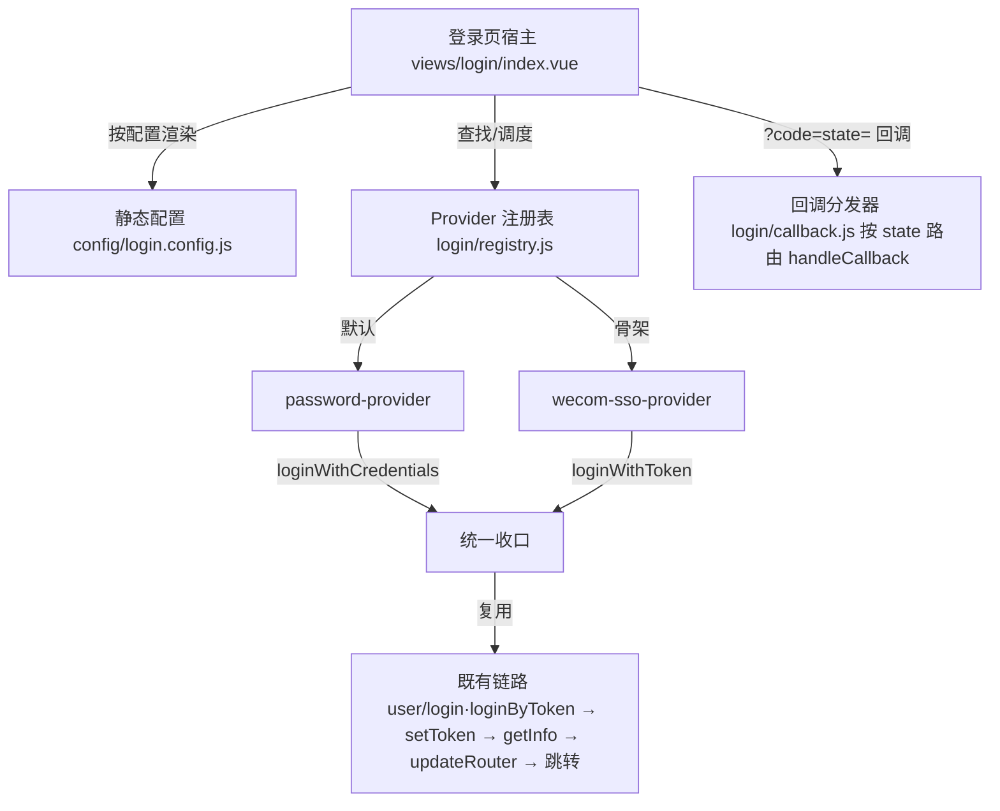

# 可插拔登录组件架构设计文档

> 适用范围：`app-ui-vue` 登录页（`src/views/login/index.vue`）及登录方式扩展能力。
> 本文描述「宿主容器 + Provider 注册表 + 统一认证收口」的登录组件架构，包含已落地的代码结构、
> 接口契约与配置方式，并给出企业微信单点登录等新方式的零侵入接入路径。
> 约束基线：Vue 2.6 + Element UI 2.15（唯一 UI 框架）、文案统一 `$t()`、HTTP 统一走 `@/utils/request`。

## 1. 背景与目标

登录页原为单一文件硬编码的「账号 + 密码」表单，接入「企业微信单点登录」等第三方方式时存在痛点：

1. **UI 难以覆盖**：SSO 可能是跳转按钮、弹窗、内嵌二维码，与硬编码表单模型不兼容。
2. **核心链路耦合**：新方式若各自实现 token 落地、路由刷新，会与既有 `user/login` 后置逻辑形成旁路。
3. **扩展成本高**：每加一种方式都要改登录页，违反开闭原则。

**架构目标**：

- 新增登录方式 = 新增一个 Provider 文件 + 注册一行 + 配置启用一行，**不改动账号密码核心流程**。
- 抽象层兼容 `redirect` / `popup` / `embedded-qr` 三种 SSO 交互模式与 `form-fields` 表单模式。
- 所有方式最终复用既有后置链路（`setToken` → `getInfo` → `updateRouter` → 跳转），Token 与路由逻辑唯一。

## 2. 总体架构与分层



**分层职责**：

| 层 | 位置 | 职责 |
|----|------|------|
| 宿主容器 | `src/views/login/index.vue` | 持有视觉骨架（极光背景/卡片/动画/语言切换），渲染启用 Provider，统一 loading 与错误提示，构造 `LoginContext`，执行后置链路 `finalizeAfterLogin` |
| 注册表 | `src/login/registry.js` | Provider 注册/查找/启用清单解析；主方式与其余方式划分 |
| 回调分发器 | `src/login/callback.js` | 按 `query.state`（兼容 `query.loginMethod`）路由到 Provider 的 `handleCallback` |
| Provider | `src/login/providers/*.js` | 各登录方式实现，仅依赖契约与 `LoginContext`，不感知宿主细节 |
| 核心链路（不变式） | `store/modules/user.js`、`utils/auth.js`、`router/`、`permission.js` | Token 落地、用户信息、动态路由、守卫；视为黑盒，Provider 不得绕过 |

## 3. 已落地代码结构

```
app-ui-vue/src/
├── config/
│   └── login.config.js                # [NEW] 登录方式静态配置（启用清单 + 方式参数）
├── login/
│   ├── index.js                       # [NEW] 能力模块入口：注册内置 Provider
│   ├── registry.js                    # [NEW] Provider 注册表 + 契约注释
│   ├── callback.js                    # [NEW] SSO 授权回调分发器
│   └── providers/
│       ├── password-provider.js       # [NEW] 账号密码（默认方式，迁移自原登录页逻辑）
│       ├── wecom-sso-provider.js      # [NEW] 企业微信 SSO 骨架（redirect 模式）
│       ├── wecom-qr-provider.js       # [NEW] 企业微信扫码骨架（embedded-qr 模式）
│       └── wecom-qr-panel.vue         # [NEW] 扫码面板自渲染组件（内嵌二维码容器）
├── views/login/index.vue              # [重构] 表单区由 Provider 驱动渲染 + 内嵌面板容器，视觉/动画不变
├── store/modules/user.js              # [新增 action] loginByToken（仅新增，不改旧）
└── i18n/zh.js · en.js                 # [新增文案] login.otherMethods / login.method.* / login.wecomNotConfigured
```

## 4. 扩展点清单

| 扩展点 | 暴露方 | 消费方 | 说明 |
|--------|--------|--------|------|
| 新登录方式 | `providers/*.js` | `src/login/index.js` 注册 | 实现 `LoginMethodProvider` 契约后 `registerProvider()` |
| 启用清单与顺序 | `config/login.config.js` 的 `enabledMethods` | 注册表 `getEnabledProviders()` | 只声明 id，第一个 `form-fields` 方式为主登录区 |
| 方式参数 | `config/login.config.js` 的 `methods` | 各 Provider | 如企微 `corpId/agentId/redirectUri` |
| 认证收口 | 宿主 `LoginContext` | Provider | `loginWithCredentials` / `loginWithToken` 两个收口 |
| 错误上报 | 宿主 `LoginContext.reportError` | Provider | 统一 `$message.error`，后端 message 已 i18n 化直接透传 |
| 回调处理 | `login/callback.js` | Provider `handleCallback` | `state` 携带 Provider id，`code` 为授权码 |
| 生命周期钩子 | 宿主 | Provider `onMounted` 等 | 预留（`embedded-qr` 等模式挂载时机） |

## 5. 接口契约

### 5.1 LoginMethodProvider（Provider 需实现）

| 字段/方法 | 类型 | 必填 | 说明 |
|-----------|------|------|------|
| `id` | string | 是 | 唯一标识；配置与回调分发均以此为准（如 `password`、`wecom-sso`） |
| `labelKey` | string | 是 | 展示文案 i18n key（禁止硬编码文案），如 `login.method.wecom` |
| `icon` | string | 否 | Element UI icon class，用于「其他登录方式」入口 |
| `interactionMode` | string | 是 | `form-fields` \| `redirect` \| `popup` \| `embedded-qr` |
| `formSchema` | Field[] | form-fields 模式 | 字段声明：`{ key, type, prefixIcon?, placeholderKey, tabindex?, toggleable?, submitOnEnter? }` |
| `formOptions` | Object | 否 | `{ rememberMe?, submitLabelKey?, submittingLabelKey? }` |
| `component` | Object | popup/embedded-qr 模式 | Provider 自渲染 Vue 组件，宿主动态渲染（预留） |
| `authenticate(context, values?)` | Promise | 是 | 认证入口：表单提交 / 入口按钮统一调用 |
| `handleCallback(query, context)` | Promise\<boolean\> | 否 | 授权回调处理，返回 `true` 表示已消费并发起登录 |
| `onMounted(context)` | void | 否 | 生命周期钩子（预留） |

### 5.2 LoginContext（宿主注入，Provider 单向依赖）

| 能力 | 签名 | 说明 |
|------|------|------|
| 翻译 | `t(key): string` | Provider 内文案统一经 i18n |
| loading 控制 | `setSubmitting(boolean): void` | 控制宿主提交态 |
| 错误上报 | `reportError(message): void` | 统一错误提示 |
| 账号密码收口 | `loginWithCredentials(credentials): Promise` | → `dispatch('user/login')` + 后置链路 |
| SSO Token 收口 | `loginWithToken({ token, rememberMe? }): Promise` | → `dispatch('user/loginByToken')` + 后置链路 |

**调用边界**：Provider → Context 单向依赖；Context → store/auth/router 走既有链路；宿主只调度 Provider，不感知具体登录逻辑。

### 5.3 注册表 API（`src/login/registry.js`）

- `registerProvider(provider)`：校验 `id/interactionMode/authenticate` 后注册。
- `getProviderById(id)`：按 id 查找。
- `getEnabledProviders()`：按 `enabledMethods` 顺序返回；**未注册的 id 静默跳过**（降级不阻塞登录页）。
- `getPrimaryProvider()`：第一个 `form-fields` 模式方式；`getSecondaryProviders()`：其余方式。

### 5.4 不变式边界（架构红线）

| 边界 | 位置 | 约定 |
|------|------|------|
| Token 落地 | `utils/auth.js` 的 `setToken` | 唯一入口，Provider 禁止自建 localStorage/Cookie 写入 |
| 用户信息 | `user/getInfo` | 登录成功后必须触发，刷新角色/部门/路由 |
| 路由刷新 | `updateRouter()` + `permission.js` 守卫 | 由宿主后置链路统一触发 |
| 跳转目标 | `router.push('/Welcome')` | Provider 不自行决定首页路由 |
| HTTP 出口 | `@/utils/request` | SSO 换票等请求必须走 request.js，继承 token 刷新/405 逻辑 |
| UI 框架 | Element UI | 禁止引入第二套 UI 框架 |

## 6. 交互模式抽象

| 模式 | 渲染路径 | 认证流 | 现状 |
|------|----------|--------|------|
| `form-fields` | 宿主按 `formSchema` 渲染输入区 + 记住我 + 提交按钮 | `authenticate(context, values)` → `loginWithCredentials` | 已落地（password） |
| `redirect` | 「其他登录方式」胶囊按钮入口 | `authenticate(context)` 发起整页跳转 → 授权页回跳 `?code&state` → `dispatchLoginCallback` → `handleCallback` → `loginWithToken` | 已落地（wecom 骨架） |
| `popup` | 同上按钮入口（或 `component` 自渲染） | `authenticate` 打开授权弹窗，监听回传消息后 → `loginWithToken` | 契约预留 |
| `embedded-qr` | 宿主渲染 Provider `component`（内嵌面板容器，含「返回账号登录」入口） | 组件内轮询/长连接取票 → `context.loginWithToken` | 已落地骨架（wecom-qr） |

新增模式不影响既有 Provider：宿主仅按「主方式 / 其他方式入口 / 自渲染组件」三类插槽渲染，无 if-else 分支膨胀。

## 7. 配置方式（前端静态配置）

`src/config/login.config.js`：

```javascript
export default {
  enabledMethods: [
    'password'
    // 'wecom-sso'
  ],
  methods: {
    'wecom-sso': {
      corpId: '',
      agentId: '',
      redirectUri: ''
    }
  }
}
```

- 启用/停用某种方式只改 `enabledMethods`，改动需前端发版（与所选配置模式一致）。
- `corpId/agentId` 为公开参数可放前端；**secret 一律由后端持有，禁止放前端**。
- `redirectUri` 须与企业微信管理后台配置的可信回调域名一致；缺省回退 `{origin}/login`。

## 8. 企业微信 SSO 接入路径（零侵入示例）

前置条件：后端提供换票接口（建议 `/public/user/login/wecom`，入参 `code`，出参 `AjaxResult{token}`）。

接入步骤（不改动任何既有核心文件）：

1. **补全换票逻辑**：在 `wecom-sso-provider.js` 的 `handleCallback` 中，经 `@/utils/request` 调用换票接口，取 `token` 后调用 `context.loginWithToken({ token })` 并返回 `true`（TODO 注释已标记位置）。
2. **填写配置**：`login.config.js` 中填入 `corpId/agentId/redirectUri`。
3. **启用方式**：`enabledMethods` 中放开 `'wecom-sso'`。
4. **后端登记**：企微管理后台配置可信域名与授权回调域；后端用 secret 调企微 API 换取用户身份并签发本系统 token。
5. **i18n**：`login.method.wecom` 中英文文案已就位，无需改动。

行为链路：点击「企业微信登录」→ 整页跳转企微授权 → 回跳 `/login?code=xxx&state=wecom-sso` → 分发器路由到 `handleCallback` → 换票 → `loginByToken` → `getInfo` → `updateRouter` → 跳转首页。

**扫码登录（embedded-qr）路径**：点击「企业微信扫码登录」入口 → 宿主将卡片区域切换渲染 `WecomQrPanel`（Provider 自渲染 `component`）→ 面板内接入企微 wwLogin SDK 展示二维码 → 扫码确认回调获得 `code` → 后端换票取 `token` → `context.loginWithToken` 收口复用统一后置链路；「返回账号登录」关闭面板回到账号密码表单。入口调度为通用规则：Provider 声明了 `component` 即走内嵌面板，否则走 `authenticate`，宿主无按方式硬编码的分支。

## 9. 演进与降级策略

- **向后端下发演进**：`enabledMethods` 未来可改为启动时经 `/public` 接口获取（租户/环境级开关），注册表 API 不变，仅替换「启用清单」来源；Provider 契约不变。
- **Provider 缺失降级**：`enabledMethods` 中未注册的 id 静默跳过，登录页照常渲染其余方式。
- **主方式缺失降级**：无任何 `form-fields` 方式时表单区不渲染（`v-if` 兜底），仅展示其他方式入口。
- **回调异常降级**：`handleCallback` 返回 `false`（未消费/参数不符）时，页面正常渲染表单，不阻塞密码登录；换票失败提示经 `reportError` 统一展示后端 message。
- **骨架安全**：`wecom-sso` 未配置 `corpId` 或未启用时不产生任何跳转行为。

## 10. 变更记录

| 版本 | 时间 | 说明 |
|------|------|------|
| 1.0.0 | 2026-09 | 初版：架构落地（宿主/注册表/回调分发/双 Provider/store 新增 loginByToken/i18n 文案），本文档与代码同步 |
