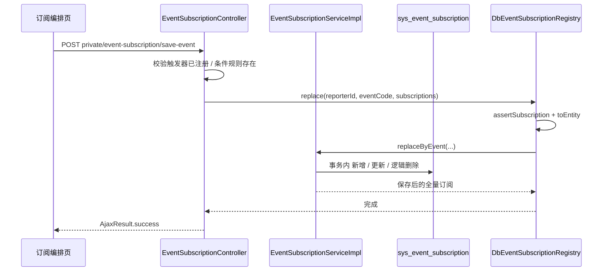

# 脚本引擎事件编排机制（事件—订阅—触发—执行）

> 适用模块：`script-engine/script-api` 的 `com.tbs.script.api.expressible` 包，以及 `app`、`system`、`shared` 中的接入实现
> 状态：与当前代码同步，接口级契约以各接口 / 抽象类的 Javadoc 为准
> 阅读对象：需要新增业务事件、自定义触发器 / 动作，或排查「事件没有触发」「动作没有执行」问题的开发者

---

## 一、整体架构与各环节职责

### 1.1 它解决什么问题

脚本引擎只回答一件事：**当某个业务事件发生时，哪些配置过的业务动作需要被执行**。

把问题拆开就是四个环节，缺一不可：

| 环节 | 回答的问题 | 契约 | 典型实现 |
|------|-----------|------|---------|
| 事件（Event） | 发生了什么？带哪些数据？ | `IEventReporter` + `EventMeta` | `BusinessEventReporter` |
| 订阅（Subscription） | 这个事件由谁处理？按什么条件？什么顺序？ | `IEventSubscriptionRegistry` + `EventSubscription` | `DbEventSubscriptionRegistry`（数据库）/ `InMemoryEventSubscriptionRegistry`（内存） |
| 触发（Trigger） | 现在到底命中没有？ | `ITrigger` + `AbstractConditionTrigger` + `IConditionEvaluator` | `ConditionRuleTrigger` |
| 执行（Execution） | 命中后做什么？按什么顺序做？ | `ITriggerAction` + `AbstractActionConditionTriggerCallback` | `PushNotifyAction`、`LogEventAction` |

编排门面 `IEventOrchestrator` 只负责把「上报」和「按订阅分发」串起来，不承载任何业务判断。

### 1.2 分层架构

```mermaid
flowchart TB
    subgraph 触发源
        A1[业务控制器埋点<br/>AdminUserController / PrivateUserController]
        A2[调试入口<br/>POST private/event-subscription/report]
    end

    subgraph app 接入层
        B[EventReportSupport<br/>统一上报门面 + 异常兜底]
        C[BusinessEventReporter<br/>IEventReporter 实现]
        D[DbEventSubscriptionRegistry<br/>@Primary 持久化订阅仓库]
        E[ConditionRuleConditionEvaluator<br/>IConditionEvaluator 实现]
        F[ConditionActionTriggerCallback<br/>动作批量解析]
        G1[PushNotifyAction]
        G2[LogEventAction]
    end

    subgraph script-api 脚本引擎层
        H[IEventOrchestrator<br/>DefaultEventOrchestrator]
        I[IEventSubscriptionRegistry]
        J[ITrigger<br/>ConditionRuleTrigger]
        K[IConditionEvaluator]
        L[AbstractActionConditionTriggerCallback]
        M[ITriggerAction]
        N[IRegistryCenter<br/>实例发现]
    end

    subgraph 存储
        O[(sys_event_subscription)]
        P[(sys_event_action)]
        Q[(sys_condition_rule)]
    end

    A1 --> B
    A2 --> B
    B --> H
    H --> C
    H --> I
    I -.-> D
    D --> O
    H --> J
    J --> K
    K -.-> E
    E --> Q
    J --> L
    L -.-> F
    F --> P
    F --> M
    M -.-> G1
    M -.-> G2
    H --> N
    N --> C
    N --> J
    N --> M
```

### 1.3 各环节职责边界

| 组件 | 位置 | 职责 | 明确不负责 |
|------|------|------|-----------|
| `IEventReporter` | `script-api/.../expressible/IEventReporter.java` | 声明本上报器支持的事件与参数；提供 `report` 钩子（扩展外部事件总线时在此转发） | 订阅、触发、动作 |
| `DefaultEventOrchestrator` | `script-api/.../orchestration/impl/` | 校验信封、定位上报器、调用上报、按订阅分发、汇总结果与耗时 | 事件参数的业务语义校验、动作的业务逻辑 |
| `IEventSubscriptionRegistry` | `script-api/.../orchestration/` | 维护「事件 → 触发器 + 条件规则编码 + 顺序」的绑定关系 | 判断条件是否命中 |
| `ITrigger` / `AbstractConditionTrigger` | `script-api/.../expressible/` | 判断是否命中，命中后执行业务回调 | 决定"命中后做什么"（交给回调） |
| `ITriggerAction` | `script-api/.../expressible/` | 执行一个具体业务动作；声明自身参数元数据 | 决定是否执行（交给触发器） |
| `AbstractActionConditionTriggerCallback` | `script-api/.../expressible/condition/` | 模板方法：解析动作 → 逐个执行 → 异常隔离 | 动作从哪来（交给子类） |
| `IRegistryCenter` | `common/.../provider/` | 实例发现：按接口类型枚举所有已注册实现 | 缓存与生命周期管理 |

### 1.4 设计取舍

1. **脚本模块与存储无关**：`script-api` 不依赖 `shared`、`system`，订阅仓库以接口形式暴露，持久化由 `app` 注入 `@Primary` 实现覆盖，避免污染中间件模块。
2. **触发器与动作解耦**：触发器只回答"命中了吗"，动作暴露参数元数据由前端渲染，二者通过 `IConditionTriggerCallback` 桥接。
3. **实时发现、不做缓存**：编排层每次都从 `IRegistryCenter` 取实例，运行时注册/注销立即生效，代价是每次调用有 O(实例数) 的枚举成本。
4. **同步串行执行**：一次事件上报在调用方线程内顺序执行全部触发器和动作，无异步、无重试、无死信，保证语义简单、结果可回执。

---

## 二、事件的定义与分类

### 2.1 事件的三元定位

一个事件由 **`(reporterId, eventCode)`** 全局定位，`eventCode` 只在所属上报器内唯一。加上参数后构成编排层的完整入参：

```java
EventEnvelope envelope = EventEnvelope.builder()
    .reporterId("BusinessEventReporter")
    .eventCode("user.created")
    .paramValues(List.of(
        ParamValue.builder().type("number").name("userId").sort(1).value("10001").build(),
        ParamValue.builder().type("string").name("userName").sort(2).value("admin").build()))
    .build();
```

> 参见 [EventEnvelope](../script-engine/script-api/src/main/java/com/tbs/script/api/expressible/orchestration/vo/EventEnvelope.java)

### 2.2 事件上报器契约

[IEventReporter](../script-engine/script-api/src/main/java/com/tbs/script/api/expressible/IEventReporter.java) 只要求实现三件事：

```java
public interface IEventReporter extends IRouteMeta {
    void report(String eventCode, Collection<ParamValue> paramValues);
    List<EventMeta> getEvents();
    String getEventReporterId();
    String getEventReporterName();
    String getEventReporterDescription();
}
```

接口已提供若干 `default` 方法降低实现成本：

| 默认方法 | 行为 | 说明 |
|---------|------|------|
| `getEventCodes()` | 从 `getEvents()` 派生事件编码集合 | 保持声明顺序（`LinkedHashSet`） |
| `getEventMeta(String)` | 按 `eventCode` 精确匹配事件元信息 | 未声明返回 `null` |
| `getMeta()` | 把 `getEventReporterId()` 写入路由坐标 `business` | 使注册中心能按 business 过滤 |

### 2.3 事件元信息与参数声明

[EventMeta](../script-engine/script-api/src/main/java/com/tbs/script/api/expressible/vo/EventMeta.java) 描述事件本身：

| 字段 | 类型 | 说明 |
|------|------|------|
| `code` | `String` | 事件编码，上报器内唯一 |
| `name` / `label` | `String` | 展示名，`label` 为空时前端回退 `name` |
| `description` | `String` | 描述 |
| `paramTypes` | `List<ParamType>` | 参数声明，可为空 |

[ParamType](../script-engine/script-api/src/main/java/com/tbs/script/api/expressible/vo/param/ParamType.java) 同时是**校验依据**与**前端渲染依据**：

| 字段 | 说明 |
|------|------|
| `type` | 语义类型（`string` / `number` 等），仅作提示 |
| `name` | 参数名，占位符 `${name}` 引用它 |
| `label` / `description` | 展示文案 |
| `sort` | 排序，与参数值顺序对齐 |
| `required` | 是否必填（前端校验用） |
| `isEnum` / `enumValues` | 枚举参数与候选值 |
| `ui` | `ParamUiMeta`：输入控件类型、占位提示、最大长度、默认值 |

### 2.4 事件的分类

| 分类维度 | 类型 | 说明 | 当前示例 |
|---------|------|------|---------|
| 声明主体 | 业务事件上报器 | 按业务域聚合多个事件 | `BusinessEventReporter` |
| | 技术事件上报器 | 框架/中间件级事件（如启动完成、配置刷新） | 暂无 |
| 参数形态 | 无参事件 | `paramTypes` 为空，编排层跳过数量校验 | 可扩展 |
| | 有参事件 | 参数数量不得超过声明数量 | `user.created` 等 |
| 触发语义 | 条件事件 | 依赖订阅上的 `ruleCode` 求值 | `ConditionRuleTrigger` |
| | 无条件事件 | 触发器自身判定，不查条件规则 | 自定义 `ITrigger` |
| 产生方式 | 业务埋点 | 业务动作成功后上报 | `AdminUserController`、`PrivateUserController` |
| | 手动调试 | 管理端 HTTP 接口上报 | `POST private/event-subscription/report` |

### 2.5 现有事件清单

[BusinessEventReporter](../app/src/main/java/com/tbs/app/service/event/reporter/BusinessEventReporter.java) 声明了四个业务事件，参数声明完全一致：

| eventCode | 常量 | 触发时机 | 参数 |
|-----------|------|---------|------|
| `user.created` | `EVENT_USER_CREATED` | 管理端新增用户成功后 | `userId`(number, 必填)、`userName`(string) |
| `user.updated` | `EVENT_USER_UPDATED` | 管理端修改用户成功后 | 同上 |
| `user.deleted` | `EVENT_USER_DELETED` | 管理端删除用户成功后 | 同上 |
| `user.loggedOut` | `EVENT_USER_LOGGED_OUT` | 私有端用户登出成功后 | 同上 |

参数由 `paramTypes()` 统一定义：

```java
ParamType.builder().type("number").name("userId")
    .label(text("event.reporter.business.param.user.id.name"))
    .required(true).sort(1)
    .ui(ParamUiMeta.builder().inputType("number").placeholder("10001").build()).build();
ParamType.builder().type("string").name("userName")
    .required(false).sort(2)
    .ui(ParamUiMeta.builder().inputType("text").placeholder("admin").maxLength(72).build()).build();
```

> `report()` 本体只写审计日志（`log.info`），因为参数校验、分发都已在编排层完成；如需对接外部事件总线（MQ、CDC），应在此方法内转发。

### 2.6 声明一个新事件的完整示例

```java
@Component
public class OrderEventReporter implements IEventReporter {

    public static final String REPORTER_ID = "OrderEventReporter";
    public static final String EVENT_ORDER_PAID = "order.paid";

    @Override
    public List<EventMeta> getEvents() {
        return List.of(EventMeta.builder()
            .code(EVENT_ORDER_PAID)
            .name("订单支付成功")
            .label("订单支付成功")
            .description("订单完成支付后上报")
            .paramTypes(List.of(
                ParamType.builder().type("string").name("orderNo").label("订单号")
                    .required(true).sort(1)
                    .ui(ParamUiMeta.builder().inputType("text").maxLength(64).build()).build(),
                ParamType.builder().type("number").name("amount").label("金额")
                    .sort(2).build()))
            .build());
    }

    @Override
    public void report(String eventCode, Collection<ParamValue> paramValues) {
        log.info("订单事件上报, eventCode={}, 参数数量={}", eventCode, paramValues.size());
    }

    @Override
    public String getEventReporterId() {
        return REPORTER_ID;
    }

    @Override
    public String getEventReporterName() {
        return "订单事件上报器";
    }

    @Override
    public String getEventReporterDescription() {
        return "上报订单支付、退款等业务事件";
    }
}
```

`@Component` 即可，无需手动注册：`@EnableScriptEngine` 通过 `AutoScriptRegister` 扫描 `com.tbs.script` 包，业务侧实现则依赖 Spring 常规扫描，再由 `IRegistryCenter` 的本地贡献者枚举到。

---

## 三、订阅注册与注销流程

### 3.1 订阅模型

[EventSubscription](../script-engine/script-api/src/main/java/com/tbs/script/api/expressible/orchestration/vo/EventSubscription.java) 是编排层的绑定对象：

| 字段 | 类型 | 说明 | 持久化映射 |
|------|------|------|-----------|
| `reporterId` | `String` | 事件上报器 ID | `reporter_id` |
| `eventCode` | `String` | 事件编码 | `event_code` |
| `triggerId` | `String` | 触发器 ID | `trigger_id` |
| `ruleCode` | `String` | 条件规则编码，为空表示不做条件判定 | `rule_code` |
| `order` | `Integer` | 执行顺序，升序，为空排最后 | `sort_order` |

### 3.2 订阅仓库契约

[IEventSubscriptionRegistry](../script-engine/script-api/src/main/java/com/tbs/script/api/expressible/orchestration/IEventSubscriptionRegistry.java) 定义了五个方法，语义是编排稳定性的关键：

| 方法 | 语义 | 幂等性 |
|------|------|--------|
| `bind(sub)` | 同一 `(reporterId, eventCode, triggerId)` 已存在时**覆盖**原绑定 | 幂等 |
| `unbind(reporterId, eventCode, triggerId)` | 精确移除一个触发器绑定，不存在时静默 | 幂等 |
| `replace(reporterId, eventCode, subs)` | 整体替换该事件下全部绑定，传空集合表示清空 | 幂等 |
| `find(reporterId, eventCode)` | 返回该事件下全部绑定，按 `order` 升序 | 只读 |
| `find(reporterId, eventCode, triggerId)` | 返回单个绑定，供条件触发器反查 `ruleCode` | 只读 |

> **注意**：`replace` 的「空集合」与「null」都表示清空，不是「保持不变」。需要「保持不变」请用 `bind`。

### 3.3 内存实现

[InMemoryEventSubscriptionRegistry](../script-engine/script-api/src/main/java/com/tbs/script/api/expressible/orchestration/impl/InMemoryEventSubscriptionRegistry.java)：

- 存储结构：`ConcurrentHashMap<String, List<EventSubscription>>`，key 为 `reporterId#eventCode`；
- 列表写入后包装为 `Collections.unmodifiableList`，读方拿到的快照不可变；
- `bind` 用 `store.compute(...)` 在同一把桶锁内完成「复制 → 移除同 triggerId → 追加 → 回写」，避免读到自己改到一半的列表；
- `find` 每次读取后按 `order` 重新排序（`nullsLast`）；
- **重启即丢**，多实例部署时各进程订阅不一致，仅适合单机演示或测试。

### 3.4 持久化实现（生产默认）

[DbEventSubscriptionRegistry](../app/src/main/java/com/tbs/app/service/event/DbEventSubscriptionRegistry.java) 标注 `@Primary`，覆盖内存实现（Spring 注入时优先选中），并委托 [IEventSubscriptionService](../system/system-api/src/main/java/com/tbs/app/service/event/IEventSubscriptionService.java)：

| 接口方法 | 实现动作 | 落库行为 |
|---------|---------|---------|
| `bind` | `listAll` 取含停用记录 → 合并（同 triggerId 覆盖） → `replace` | 增量新增 / 更新 |
| `unbind` | `listAll` 过滤掉目标 triggerId → `replace` | 被移除记录逻辑删除 |
| `replace` | 校验非空 reporterId / eventCode → 逐条校验 → `toEntity` → `service.replaceByEvent` | 增量合并 + 逻辑删除残留 |
| `find` | `service.listEnabled` → `toSubscription` → 按 `order` 升序 | 仅返回 `enabled=1, flag=1` |
| `find(3 参)` | `service.findEnabled` | 停用视为未绑定 |

**为什么读取不用缓存**：管理端「保存即生效」是硬需求，且订阅数据量小（单事件下通常个位数），一次索引查询成本远低于缓存失效的复杂度。

**为什么写操作走 `replaceByEvent`**：避免「先删后插」的中间态——事务内按业务键做增/改/删三类判定，外部观察不到空订阅窗口。

`replaceByEvent` 的增量语义（`EventSubscriptionServiceImpl`）：

```text
1. 组装 incoming: Map<triggerId, entity>，同事件内 triggerId 重复直接报错
2. 查询 existing: 含停用记录，Map<triggerId, entity>
3. 遍历 incoming：
   - existing 中不存在 → save（新增，enabled 缺省为 1）
   - existing 中存在   → 就地更新 ruleCode / sortOrder / enabled（enabled 未传则保留原值）→ save
4. existing 中剩余的（本次未提交）→ deleteById（逻辑删除）
5. 返回 queryByEvent(onlyEnabled=false)
```

整个方法标注 `@Transactional(rollbackFor = Exception.class)`，任一条非法直接回滚。

### 3.5 注册链路（时序）



> 之后的下一次事件上报会直接读到新配置，无需重启或手动刷新。

### 3.6 注销链路

三种注销方式，语义由窄到宽：

| 方式 | 入口 | 影响范围 | 适用场景 |
|------|------|---------|---------|
| 单条删除 | `POST private/event-subscription/delete/{id}` | 一条绑定（逻辑删除 `flag=0`） | 管理页删除按钮 |
| 整体清空 | `POST private/event-subscription/save-event` 传空列表 | 该事件下全部绑定 | 重置某事件编排 |
| 停用 | `POST private/event-subscription/disable/{id}` | `enabled=0`，记录保留 | 灰度关闭、临时止血 |

停用与删除在编排层的表现一致——`find` 只返回启用记录，因此**停用的触发器不会再被分发**。

### 3.7 管理端接口一览

| 方法 | 路径 | 说明 |
|------|------|------|
| GET | `private/event-subscription/reporters` | 列出上报器摘要（id / name / description / eventCodes） |
| GET | `private/event-subscription/events?reporterId=` | 按上报器列出事件与参数声明 |
| GET | `private/event-subscription/triggers` | 列出触发器元信息 |
| GET | `private/event-subscription/by-event?reporterId=&eventCode=` | 按事件回显订阅 |
| POST | `private/event-subscription/save-event` | 整体替换某事件订阅 |
| POST | `private/event-subscription/save` | 单条新增 / 更新 |
| POST | `private/event-subscription/query` | 分页查询 |
| POST | `private/event-subscription/delete/{id}` | 逻辑删除 |
| POST | `private/event-subscription/enable/{id}` · `disable/{id}` | 启停 |
| POST | `private/event-subscription/report` | 调试上报，返回分发明细 |

权限点：`API.DEV.EVENT.SUBSCRIPTION.QUERY` / `SAVE` / `DELETE`。

---

## 四、事件触发条件与传播方式

### 4.1 上报与分发主链路

[DefaultEventOrchestrator.report](../script-engine/script-api/src/main/java/com/tbs/script/api/expressible/orchestration/impl/DefaultEventOrchestrator.java) 的步骤是固定的：

```text
1. assertEnvelope          校验信封非空、reporterId 非空、eventCode 非空（USER_INPUT_ERROR，抛出）
2. findReporter            从注册中心遍历找 IEventReporter，找不到抛 SYSTEM_ERROR
3. reporter.getEventMeta   事件未声明抛 USER_INPUT_ERROR
4. assertParamCount        参数数量 > 声明数量时抛 USER_INPUT_ERROR；声明为空则跳过
5. reporter.report(...)    调用上报器本体；异常被捕获，返回 reported=false 并终止（不分发）
6. resolveSubscribedTriggerIds  查订阅，取 triggerId，LinkedHashSet 去重保序
7. doDispatch              加载触发器实例并逐个 trigger()
8. 汇总 EventReportResult(reported, dispatch, success, elapsedMs)
```

### 4.2 条件编码的解析优先级

条件触发器 [AbstractConditionTrigger](../script-engine/script-api/src/main/java/com/tbs/script/api/expressible/condition/AbstractConditionTrigger.java) 的判定逻辑：

```text
resolveConditionCode(reporterId, eventCode):
    1. subscriptionRegistry.find(reporterId, eventCode, triggerId)
    2. 命中且 subscription.ruleCode 非空 → 用它
    3. 否则 → defaultConditionCode()（默认返回 null）
    4. 仍为空 → 视为未命中
```

| 场景 | `ruleCode` | 结果 |
|------|-----------|------|
| 订阅上配置了规则 | 非空 | 按该规则求值 |
| 订阅未配置，触发器有默认规则 | 空 | 用 `defaultConditionCode()` |
| 订阅未配置，触发器无默认规则 | 空 | **永不触发**（`ConditionRuleTrigger` 即属于此类） |

> 这是一条高频踩坑点：`ConditionRuleTrigger` 不提供默认条件编码，**不配 `ruleCode` 就永远不会命中**。若需要无条件执行，应自定义触发器或在订阅上配置一个恒为真的规则。

### 4.3 条件求值

[IConditionEvaluator](../script-engine/script-api/src/main/java/com/tbs/script/api/expressible/condition/IConditionEvaluator.java) 的契约非常克制：

```java
boolean evaluate(String conditionCode);
```

**任何不可用场景都必须返回 `false` 而不是抛异常**（条件不存在、已停用、载荷非法、执行异常）。平台侧适配器 [ConditionRuleConditionEvaluator](../app/src/main/java/com/tbs/app/service/condition/ConditionRuleConditionEvaluator.java) 把 `conditionCode` 当作条件规则编码，委托 `ConditionRuleEvaluator.evaluate`，并在外层再包一层 `try/catch` 返回 `false`：

```java
public boolean evaluate(String conditionCode) {
    if (StrUtil.isBlank(conditionCode)) {
        return false;
    }
    try {
        return conditionRuleEvaluator.evaluate(conditionCode);
    } catch (Exception e) {
        log.warn("条件规则求值适配失败, ruleCode={}, 原因={}", conditionCode, e.getMessage());
        return false;
    }
}
```

条件规则本身以「取值器（getter）编排」为基础，规则内容、逻辑组合、参数配置不在本文范围。

### 4.4 `isTrigger` 与 `trigger` 的分工

`ITrigger` 明确要求**不要**先 `isTrigger` 再 `trigger`：

| 方法 | 是否产生副作用 | 用途 |
|------|--------------|------|
| `trigger(...)` | 命中时执行回调 | 生产路径唯一入口，返回值即是否真正触发 |
| `isTrigger(...)` | 无 | 仅预览 / 调试 |

`AbstractConditionTrigger.trigger` 内部仍会调用一次 `isTrigger` 做条件判定，但对外只暴露一次调用，避免 TOCTOU（判定与执行之间状态漂移）：

```java
public final boolean trigger(String reporterId, String eventCode, Collection<ParamValue> paramValues) {
    if (!isTrigger(reporterId, eventCode, paramValues)) {
        return false;
    }
    try {
        onTriggered(reporterId, eventCode, paramValues);
        return true;
    } catch (Exception e) {
        log.error("条件触发器回调异常, 视为未触发, ...");
        return false;
    }
}
```

### 4.5 传播方式

| 维度 | 现状 | 含义 |
|------|------|------|
| 调用模型 | 同步 | 在调用方线程内完成上报 + 全部分发，`report()` 返回时动作已执行完 |
| 传播介质 | 进程内方法调用 | 默认无 MQ、无事件总线，跨实例不广播 |
| 分发范围 | 单次事件 × 该事件全部启用订阅 | 不支持通配订阅（如 `user.*`） |
| 触发器并发 | 串行 | 按订阅顺序逐个执行，前一触发器结束才进入下一个 |
| 失败传播 | 隔离 | 单触发器异常被捕获并记入 `TriggerResult`，不影响后续触发器 |
| 重试 | 无 | 动作失败只记录日志，不重投 |

> 若后续需要跨实例广播，正确做法是在 `IEventReporter.report` 内投递 MQ，由消费端再调用 `IEventOrchestrator.dispatch`，而不是改造编排层。

### 4.6 三种分发入口的差异

| 入口 | 是否调用上报器 | 触发器来源 | 典型用途 |
|------|--------------|-----------|---------|
| `report(envelope)` | 是 | 订阅关系 | 业务埋点、调试上报 |
| `dispatch(envelope)` | 否 | 订阅关系 | 事件已由外部投递，仅补分发 |
| `dispatch(envelope, triggerIds)` | 否 | 调用方指定列表 | 定向预览；**条件触发器仍需订阅存在才能取到 `ruleCode`** |

三种入口最终都收敛到同一个 `doDispatch`，结果结构一致。

---

## 五、执行阶段的调度与顺序控制

### 5.1 两级顺序

顺序控制在两个层级独立生效，互不干扰：

| 层级 | 顺序来源 | 排序位置 | 说明 |
|------|---------|---------|------|
| 触发器级 | `sys_event_subscription.sort_order` → `EventSubscription.order` | `DbEventSubscriptionRegistry.find` 排序 + SQL `ORDER BY sort_order ASC` | 决定多个触发器谁先判定 |
| 动作级 | `sys_event_action.sort_order` | `EventActionServiceImpl.queryByEvent` 的 `orderByAsc` | 决定命中后多个动作谁先执行 |

另外 `ITriggerAction extends Ordered`，其 `getOrder()` 只用于 `TriggerActionQueryService.listActions()` 的**元数据展示排序**（`order` 升序、`actionId` 兜底），不参与运行期动作顺序——运行期顺序完全由绑定表决定。

`order` 为空时排在末尾（`Comparator.nullsLast`），因此业务上应显式填写，避免依赖默认值。

### 5.2 动作解析与执行的模板方法

[AbstractActionConditionTriggerCallback](../script-engine/script-api/src/main/java/com/tbs/script/api/expressible/condition/AbstractActionConditionTriggerCallback.java) 把「解析」与「执行」分开，执行部分是不可覆写的统一逻辑：

```text
onTriggered(reporterId, eventCode, paramValues)
    ├─ resolveInvocations(...)                     ← 子类可覆写（批量解析）
    ├─ 空 → log.debug("命中但未配置动作") → return
    └─ for each invocation:
           action == null → continue
           action.execute(paramValues)             ← try/catch，异常仅 warn
```

两个传统抽象方法 `resolveActions` / `resolveActionParamValues` 保留，`resolveInvocations` 的默认实现就是把二者串起来，因此**老实现零改动**：

```java
protected List<ActionInvocation> resolveInvocations(String reporterId, String eventCode,
    Collection<ParamValue> paramValues) {
    List<ITriggerAction> actions = resolveActions(reporterId, eventCode, paramValues);
    if (actions == null || actions.isEmpty()) {
        return List.of();
    }
    List<ActionInvocation> invocations = new ArrayList<>(actions.size());
    for (ITriggerAction action : actions) {
        if (action == null) {
            continue;
        }
        invocations.add(new ActionInvocation(action,
            resolveActionParamValues(reporterId, eventCode, paramValues, action.getActionId())));
    }
    return invocations;
}
```

> 若子类同时重写 `resolveInvocations` 和两个传统方法，需保证语义一致——生产实现 [ConditionActionTriggerCallback](../app/src/main/java/com/tbs/app/service/event/condition/ConditionActionTriggerCallback.java) 是把两个传统方法**委托**给 `resolveInvocations` 的单向实现，避免两套逻辑漂移。

### 5.3 生产实现：一次查询解析全部动作

`ConditionActionTriggerCallback.resolveInvocations` 的执行步骤：

```text
1. eventActionService.listEnabled(reporterId, eventCode)      ← 一次查询，按 sort_order 升序
2. 空 → List.of()
3. for each binding:
     a. triggerActionQueryService.getActionInstance(actionId)
        - null → log.warn("事件动作未注册, 已跳过") → continue
     b. parseParams(binding)
        - paramJson 为空 → List.of()
        - JSON 非法 → log.warn("参数解析失败, 已跳过") → return null → continue
     c. ActionParamInterpolator.interpolate(params, paramValues)   ← 事件参数替换占位符
     d. new ActionInvocation(action, interpolatedParams)
```

设计意图：

- **消除 N+1**：动作绑定一次查出，不在循环内反复查库；
- **降级而非失败**：动作下线（实例缺失）、参数被手改成非法 JSON，都只跳过该动作，不影响同事件下其它动作；
- **动作实例不缓存**：与触发器保持一致，注册/注销立即生效。

### 5.4 动作契约与参数读取

[ITriggerAction](../script-engine/script-api/src/main/java/com/tbs/script/api/expressible/ITriggerAction.java)：

```java
public interface ITriggerAction extends IRouteMeta, IRequestable, Ordered {
    String getActionName();
    String getActionId();
    String getActionDesc();
    void execute(Collection<ParamValue> paramValues);
    default List<ParamType> requestParamTypes() { return List.of(); }  // 来自 IRequestable
}
```

参数读取统一走 [AbstractActionSupport](../app/src/main/java/com/tbs/app/service/event/action/AbstractActionSupport.java)：

```java
protected String paramString(Collection<ParamValue> paramValues, int index)
```

**按位置下标读取，不按参数名匹配**。这与取值器（getter）体系的参数对齐语义一致：第 N 个参数就是 `requestParamTypes()` 里 `sort` 第 N 个声明。因此：

- 保存配置时参数顺序必须与 `requestParamTypes()` 顺序一致；
- 运行期若事件参数数量不足，`paramString` 返回 `null`，由动作自行决定校验强度（如 `LogEventAction` 对缺失 `message` 抛断言，对缺失 `level` 降级为 `info`）。

### 5.5 参数占位符插值

[ActionParamInterpolator](../app/src/main/java/com/tbs/app/service/event/ActionParamInterpolator.java) 让动作真正消费事件载荷：

| 规则 | 说明 |
|------|------|
| 占位符格式 | `${paramName}`，正则为 `\$\{([A-Za-z0-9_.-]+)}` |
| 触发条件 | 参数值包含 `"${"` 才做替换，否则原样返回（零成本快路径） |
| 未匹配 | 保留原占位符文本，便于在调试区看出配置缺失 |
| 特殊字符 | 使用 `Matcher.quoteReplacement`，值中含 `$` / `\` 不会抛异常 |
| 同名参数 | `LinkedHashMap` 覆盖，后者生效 |
| 保留字段 | `type` / `name` / `sort` 不变，仅替换 `value` |
| 空入参 | 动作参数为空返回 `List.of()`；无事件参数时整批原样返回 |

示例：

```text
动作参数 title   = "新用户 ${userName} 已创建"
事件参数         = userName="admin", userId="10001"
插值后 title     = "新用户 admin 已创建"
```

也可对单个字符串直接插值：

```java
String text = ActionParamInterpolator.interpolate("订单 ${orderNo} 支付成功", eventParams);
```

### 5.6 顺序控制的实践建议

1. **触发器顺序**用于表达「先判定轻量条件、再判定重规则」，或用不同规则码实现分段开关；
2. **动作顺序**用于表达副作用依赖，例如「先写审计日志，再发通知」；
3. 同一事件下 `triggerId` / `actionId` 不允许重复（Service 层校验，非唯一索引），因此不存在同动作并行两个绑定的情况；
4. 顺序调整只需改 `sort_order`，无需改代码。

---

## 六、数据流转与依赖关系

### 6.1 一次完整调用的数据流

| 阶段 | 输入 | 处理 | 输出 |
|------|------|------|------|
| 埋点 | 业务对象（`Long userId`、`String userName`） | `EventReportSupport.toParamValues(Map)` | `List<ParamValue>`（`type=string`，`sort` 按 Map 迭代自增） |
| 上报 | `reporterId`、`eventCode`、`List<ParamValue>` | 组装 `EventEnvelope` | `EventEnvelope` |
| 编排 | `EventEnvelope` | 校验 + 定位上报器 + 调用 `report` | 上报成功 / `EventReportResult(reported=false)` |
| 订阅 | `(reporterId, eventCode)` | `listEnabled` 查库 + 排序 | `List<EventSubscription>` |
| 分发 | 订阅列表 | 取 `triggerId` 去重保序 → 加载触发器实例 | `List<String>` → `Map<String, ITrigger>` |
| 触发 | 触发器 + 信封 | `isTrigger` → `onTriggered` | `boolean` + 耗时 |
| 动作解析 | `(reporterId, eventCode)` | `listEnabled` 查动作绑定 → 解析实例 → 解析参数 JSON → 插值 | `List<ActionInvocation>` |
| 动作执行 | `ActionInvocation` | `action.execute(paramValues)` | 副作用（推送 / 日志） |
| 汇总 | 全部 `TriggerResult` | 计数与耗时 | `EventReportResult → EventDispatchResult → List<TriggerResult>` |

### 6.2 数据形态变化示例

```text
[业务层]  Map {userId=10001, userName=admin}
              │ toParamValues
              ▼
[参数值]  [ {type:"string", name:"userId", sort:1, value:"10001"},
            {type:"string", name:"userName", sort:2, value:"admin"} ]
              │ EventEnvelope
              ▼
[订阅]    {reporterId:"BusinessEventReporter", eventCode:"user.created",
           triggerId:"ConditionRuleTrigger", ruleCode:"rule_user_welcome", order:1}
              │ 条件求值命中
              ▼
[动作绑定] {actionId:"PushNotifyAction", paramJson:"[{name:'msgType',value:'event.notify'},
            {name:'title',value:'新用户 ${userName} 已创建'}]"}
              │ interpolate
              ▼
[动作执行] PushNotifyService.send({msgType:"event.notify", title:"新用户 admin 已创建", source:"event"})
```

### 6.3 模块依赖方向

```text
script-api (com.tbs.script.api.expressible)
    ├─ 依赖：common（IRegistryCenter / IRouteMeta / AssertUtil / I18nUtil / StrUtil / CollUtil）
    ├─ 不依赖：shared、system、app
    └─ 被依赖：app（业务接入）、default-system-impl（仅存实体无关的服务契约层不涉及）

app
    ├─ 依赖 script-api（编排、触发器、动作契约）
    ├─ 依赖 system-api（IEventSubscriptionService / IEventActionService）
    └─ 提供 @Primary 订阅仓库、上报器、触发器回调、动作实现

system-api ← default-system-impl
    └─ 依赖 shared-api（Mapper）与 shared-pojo（实体 / Criteria）

shared-pojo → sys_event_subscription / sys_event_action 实体与索引声明
```

这条依赖链保证了中间件模块（script）可以独立演进，业务存储细节不会侵入脚本引擎。

### 6.4 关键注入点

| 注入点 | 类型 | 来源 | 覆盖方式 |
|--------|------|------|---------|
| `IEventSubscriptionRegistry` | 接口 | `InMemoryEventSubscriptionRegistry`（script） | `DbEventSubscriptionRegistry` 标 `@Primary` |
| `IConditionEvaluator` | 接口 | 无默认实现 | `ConditionRuleConditionEvaluator`（app） |
| `IConditionTriggerCallback` | 接口 | 可零到多个 | `ConditionActionTriggerCallback`（app），由 `ObjectProvider.orderedStream()` 按 `@Order` 排序 |
| `IEventReporter` | 接口 | 可多个 | `BusinessEventReporter` 等业务实现 |
| `ITrigger` | 接口 | 可多个 | `ConditionRuleTrigger` 等 |
| `ITriggerAction` | 接口 | 可多个 | `PushNotifyAction`、`LogEventAction` |

### 6.5 表结构与字段映射

**`sys_event_subscription`**

| 列 | 类型 | 说明 |
|----|------|------|
| `id` | bigint | 主键 |
| `reporter_id` / `event_code` / `trigger_id` | varchar(128) | 绑定坐标 |
| `rule_code` | varchar(64) | 条件规则编码，可空 |
| `sort_order` | int | 执行顺序 |
| `enabled` / `flag` | int | 业务状态 / 逻辑删除 |
| 审计列 | — | `create_time`、`update_time`、`create_by`、`update_by` |

索引：`idx_event_subscription_event(reporter_id, event_code, sort_order)`、`idx_event_subscription_enabled(enabled)`、`idx_event_subscription_flag(flag)`。

**`sys_event_action`**

| 列 | 类型 | 说明 |
|----|------|------|
| `id` | bigint | 主键 |
| `reporter_id` / `event_code` / `action_id` | varchar(128) | 绑定坐标 |
| `action_name` | varchar(128) | 展示快照，动作改名后不回溯 |
| `param_json` | text | `List<ParamValue>` JSON，与条件规则 `invocationJson` 同构 |
| `sort_order` / `enabled` / `flag` | int | 顺序 / 状态 / 逻辑删除 |
| 审计列 | — | 同上 |

索引：`idx_event_action_event(reporter_id, event_code, sort_order)`、`idx_event_action_enabled(enabled)`、`idx_event_action_flag(flag)`。

> 唯一性（同事件下同触发器 / 同动作不重复）由 Service 层校验，**不用唯一索引**，以便逻辑删除与历史数据共存。

---

## 七、异常与错误处理策略

### 7.1 总原则

> **配置错误向外抛，运行故障向内吞。**

- 参数缺失、编码超长、绑定重复、动作未注册 —— 属于开发者配置错误，立即抛断言让管理端看到明确提示；
- 触发器异常、动作异常、条件规则不可用 —— 属于运行期故障，就地降级并记录日志，不中断整条链路。

### 7.2 分层策略

| 层 | 异常类型 | 处理方式 | 结果表现 |
|----|---------|---------|---------|
| 编排校验 | 信封为空 / ID 为空 / 事件未声明 / 参数超限 | `AssertUtil.i18n(...).throwIt()` | HTTP 层返回业务错误 |
| 编排校验 | 上报器未注册 | `SYSTEM_ERROR` 抛出 | 服务端配置问题 |
| 上报器调用 | `reporter.report` 抛异常 | 捕获，`log.warn`，返回失败回执 | `reported=false, success=false`，不再分发 |
| 分发 | 触发器实例缺失 | 记录 `TriggerResult.errorMsg`，`success=false`，继续 | 该触发器标记失败 |
| 分发 | 触发器抛异常 | 捕获，`log.warn`，`success=false`，继续 | 该触发器标记失败 |
| 触发器 | 依赖缺失 / 条件编码为空 / 求值异常 | 就地返回 `false` | 视为未命中 |
| 触发器 | 命中回调异常 | `log.error` + 返回 `false` | 视为未触发 |
| 动作解析 | 动作实例缺失 | `log.warn` + `continue` | 跳过该动作 |
| 动作解析 | `paramJson` 非法 | `log.warn` + `continue` | 跳过该动作 |
| 动作执行 | `execute` 抛异常 | `log.warn` + 继续下一个动作 | 其余动作照常执行 |
| 埋点 | 任意异常 | `reportQuietly` 捕获并返回失败回执 | 不影响主业务事务 |

### 7.3 结果对象的三态语义

`TriggerResult` 用两个布尔量表达三种状态，判断时不能只看一个：

| `triggered` | `success` | 含义 | 表现 |
|------------|-----------|------|------|
| `true` | `true` | 条件命中且动作执行完成 | 绿色 |
| `false` | `true` | 条件未命中，属正常 | 灰色 |
| `false` | `false` | 触发器缺失或执行异常 | 红色 |

聚合层语义：

| 对象 | 字段 | 语义 |
|------|------|------|
| `EventDispatchResult.success` | 全部触发器均被成功调用 | **不代表有触发器命中**（无触发器时也为 `true`） |
| `EventDispatchResult.triggeredCount` | 真正命中的数量 | 判断"有没有生效"看这个 |
| `EventReportResult.reported` | 上报器调用是否成功 | 失败时 `dispatch` 为 `null` |
| `EventReportResult.success` | `reported && dispatch.success` | 整体链路健康度 |

### 7.4 埋点隔离

业务侧必须用 `reportQuietly`：

```java
Map<String, Object> params = new LinkedHashMap<>();
params.put(BusinessEventReporter.PARAM_USER_ID, userId);
params.put(BusinessEventReporter.PARAM_USER_NAME, userName);
eventReportSupport.reportQuietly(BusinessEventReporter.REPORTER_ID, BusinessEventReporter.EVENT_USER_CREATED, params);
```

[EventReportSupport](../app/src/main/java/com/tbs/app/service/event/EventReportSupport.java) 的两个方法分工明确：

| 方法 | 异常行为 | 适用场景 |
|------|---------|---------|
| `report(...)` | 向上抛 | 调试接口、需要感知失败的场景 |
| `reportQuietly(...)` | 捕获全部异常，返回 `EventReportResult(reported=false, success=false, errorMsg, elapsedMs)` | **所有业务埋点** |

埋点位置统一在业务动作成功返回之后，不参与业务事务：

```java
// AdminUserController.save
boolean created = entity != null && entity.getId() == null;
AjaxResult result = super.save(entity);
reportUserEvent(created ? BusinessEventReporter.EVENT_USER_CREATED : BusinessEventReporter.EVENT_USER_UPDATED,
    entity == null ? null : entity.getId(), entity == null ? null : entity.getUserName());
return result;
```

```java
// AdminUserController.reportUserEvent —— 统一埋点方法
private void reportUserEvent(String eventCode, Long userId, String userName) {
    Map<String, Object> params = new LinkedHashMap<>();
    params.put(BusinessEventReporter.PARAM_USER_ID, userId);
    params.put(BusinessEventReporter.PARAM_USER_NAME, userName);
    eventReportSupport.reportQuietly(BusinessEventReporter.REPORTER_ID, eventCode, params);
}
```

删除与登出同理：`AdminUserController.delete` 先查旧数据取用户名，再 `super.delete(id)`，成功后上报 `user.deleted`；`PrivateUserController` 登出成功后上报 `user.loggedOut`。

### 7.5 日志约定

| 场景 | 级别 | 关键字段 |
|------|------|---------|
| 上报失败 | `warn` | reporterId、eventCode、参数摘要（单值截断 100 字符）、耗时、异常 |
| 触发器未注册 | `warn` | reporterId、eventCode、triggerId |
| 触发器执行失败 | `warn` | triggerId、耗时、异常 |
| 条件求值异常 | `warn` | triggerId、ruleCode |
| 命中回调异常 | `error` | triggerId、回调类名 |
| 动作未注册 / 参数非法 / 执行异常 | `warn` | actionId、异常 |
| 编排完成 | `debug` | 触发器数量、命中数量、耗时 |

参数摘要只输出 `name=value` 且单值截断，避免大对象或敏感长文本整段入日志。

### 7.6 i18n 资源

| 资源文件 | 覆盖范围 |
|---------|---------|
| `script-engine/script-api/src/main/resources/i18n/messages-script*.properties` | `script.orchestration.*`（信封、上报器、事件、参数、触发器、订阅校验）、`script.trigger.*`（触发器名称/描述、动作缺失） |
| `app/src/main/resources/i18n/messages-app*.properties` | `event.reporter.*`（上报器与事件文案）、`event.action.*`（动作、参数、枚举、校验） |
| `system/default-system-impl/src/main/resources/messages-system*.properties` | `event.subscription.*`、`event.action.*` 的持久化层校验文案 |

约束：

- 常量集中在 [ScriptI18nConstant](../script-engine/script-api/src/main/java/com/tbs/script/api/expressible/constant/ScriptI18nConstant.java)，禁止散落字符串；
- 中英文两份必须同步新增，缺英文会回退到中文 key 或原文；
- 触发器 / 动作的名称与描述由实现类通过 `I18nUtil` 在**调用时**读取，不做静态缓存，因此切换语言后立即生效。

---

## 八、并发与性能考量

### 8.1 线程模型

| 环节 | 线程 | 是否存在共享可变状态 |
|------|------|-------------------|
| `report` | 调用方线程（Web 请求线程） | 无（每次新建 `EventEnvelope`、`ArrayList`） |
| 分发 | 同上 | `loadTriggers` 每次新建 `LinkedHashMap` |
| 触发器 | 同上 | `AbstractConditionTrigger` 无可变字段（依赖通过 `@Resource` 注入） |
| 动作 | 同上 | 动作实现应为无状态；`PushNotifyAction` 仅持有服务引用 |
| 订阅写入 | 管理端线程 | 内存实现用 `ConcurrentHashMap.compute` 保证原子；DB 实现依赖事务 |

结论：**整个编排链路是同步串行、无状态、可重入的**，多线程并发上报互不影响。

### 8.2 并发安全细节

| 组件 | 机制 |
|------|------|
| `InMemoryEventSubscriptionRegistry` | `ConcurrentHashMap.compute` / `computeIfPresent` 原子替换；读取返回 `unmodifiableList` 快照 |
| `DbEventSubscriptionRegistry` | 读无锁（每次查库）；写走 `@Transactional` 的 `replaceByEvent` |
| `AbstractConditionTrigger` | 只读注入 + 局部变量，无共享状态 |
| `ConditionActionTriggerCallback` | 无状态，仅持有两个服务引用 |
| `ActionParamInterpolator` | 纯静态工具，无状态 |

> 注意：DB 实现没有乐观锁版本号，并发保存同一事件订阅时「后提交者胜出」。管理端属单人配置场景，可接受。

### 8.3 性能成本

单次 `report` 的开销分布（n = 订阅数，T = 触发器实例总数，A = 动作实例总数）：

| 步骤 | 复杂度 | 说明 |
|------|--------|------|
| 定位上报器 | O(R) | 遍历注册中心全部 `IEventReporter` 实例 |
| 查订阅 | O(log n + n) | 走 `(reporter_id, event_code, sort_order)` 复合索引；n 通常为个位数 |
| 加载触发器 | O(T) | **每次上报全量拉取并按 ID 建映射**，不做缓存 |
| 逐个触发 | O(n × 条件求值) | 串行；条件求值内部再查条件规则 |
| 查动作绑定 | O(log m + m) | 每个命中的触发器一次查询 |
| 定位动作实例 | O(m × A) | 每个动作一次注册中心遍历 |
| 动作执行 | 取决于动作实现 | 推送动作含一次 `pushNotifyService.send` |

### 8.4 为什么不缓存

- **实例**：注册中心（`IRegistryCenter`）本身按贡献者聚合，运行期可注册/注销；编程式缓存会引入失效问题，且实例数远小于数据库压力；
- **订阅**：管理端要求「保存立即生效」，缓存需要广播失效机制，复杂度高于收益；
- **代价可接受**：单事件订阅数与动作绑定数都是人工配置量级（个位数到十几条），一次上报的总查询量在 2~3 次数据库访问内。

若某事件确实高频（如每秒数百次），推荐做法是**降低埋点频率或异步化埋点**（见 8.6），而不是给编排层加缓存。

### 8.5 索引设计

两张绑定表都采用同样的三组索引：

```text
(reporter_id, event_code, sort_order)   -- 服务两个查询：按事件列表 + 按事件排序，最左前缀还支持按 reporter 过滤
(enabled)                               -- 纯状态列，便于统计与批量启停
(flag)                                  -- 逻辑删除列
```

之所以不用唯一索引约束 `(reporter_id, event_code, trigger_id)`：逻辑删除会保留历史行，唯一索引会导致「删了之后无法再建同一条绑定」。重复校验因此放在 Service 层，同时校验「本次提交内部是否重复」与「与现存有效记录是否重复」。

### 8.6 与主业务事务的关系

- 埋点位于业务返回**之后**，不参与业务事务；
- `reportQuietly` 吞掉全部异常，事件链路故障不会回滚业务；
- 但编排本身**同步执行**，动作耗时（尤其推送）会叠加到接口响应时间。若动作较重，建议：
  1. 在动作实现内部异步化（自行提交线程池）；
  2. 或改为「上报投递 MQ + 消费端 dispatch」；
  3. 或先用 `enabled=0` 停用该动作止血。

### 8.7 容量建议

| 指标 | 建议值 | 理由 |
|------|--------|------|
| 单事件订阅数 | ≤ 10 | 串行判定，且配置可读性下降 |
| 单事件动作数 | ≤ 10 | 串行执行，耗时线性叠加 |
| 单次上报参数数 | ≤ 20 | 超过后日志摘要与前端表单都不友好 |
| 单动作参数值长度 | ≤ 1000 字符 | `param_json` 为 text，前端控件设了 maxLength |

---

## 九、扩展与自定义事件支持

### 9.1 新增业务事件

| 步骤 | 操作 | 注意点 |
|------|------|--------|
| 1 | 新建类实现 `IEventReporter`，标 `@Component` | 必须在 Spring 扫描范围内 |
| 2 | `getEvents()` 声明事件与 `paramTypes` | `code` 全局建议用 `域.动作` 命名 |
| 3 | `getEventReporterId()` 返回稳定 ID | 一旦写入订阅表就不宜变更 |
| 4 | `report()` 写审计日志或转发外部总线 | 不要在此处做业务动作 |
| 5 | 在业务节点调用 `EventReportSupport.reportQuietly` | 放在成功返回之后 |
| 6 | 补 i18n（中英文） | 名称/描述/参数标签都要 |

事件与上报器的关系是「多对一」：一个上报器声明多个事件，前端先选上报器再选事件。

### 9.2 新增触发器

**方式一（推荐）：继承 `AbstractConditionTrigger`**

只需实现 `onTriggered`，并可覆写 `defaultConditionCode()` 提供默认条件：

```java
@Component
public class RiskConditionTrigger extends AbstractConditionTrigger {

    @Override
    public String getTriggerId() {
        return "RiskConditionTrigger";
    }

    @Override
    public String getTriggerName() {
        return "风险条件触发器";
    }

    @Override
    public String getDescription() {
        return "风控规则命中后执行风控动作";
    }

    @Override
    protected String defaultConditionCode() {
        return "rule_risk_default";   // 订阅未配置 ruleCode 时使用
    }

    @Override
    protected void onTriggered(String reporterId, String eventCode, Collection<ParamValue> paramValues) {
        // 命中后的业务逻辑
    }
}
```

**方式二：直接实现 `ITrigger`**

适用于完全自定义判定语义（如按事件参数阈值判断，不依赖条件规则）：

```java
@Component
public class AmountThresholdTrigger implements ITrigger {

    @Override
    public boolean trigger(String reporterId, String eventCode, Collection<ParamValue> paramValues) {
        return isTrigger(reporterId, eventCode, paramValues);
    }

    @Override
    public boolean isTrigger(String reporterId, String eventCode, Collection<ParamValue> paramValues) {
        return paramValues.stream()
            .filter(p -> "amount".equals(p.getName()))
            .anyMatch(p -> Double.parseDouble(p.getValue()) >= 10000);
    }

    @Override
    public String getTriggerId() {
        return "AmountThresholdTrigger";
    }

    @Override
    public String getTriggerName() {
        return "大额交易触发器";
    }

    @Override
    public String getDescription() {
        return "事件金额达到阈值时触发";
    }
}
```

约束：

- 必须是 Spring Bean（`AbstractConditionTrigger` 依赖注入求值器与订阅仓库）；
- `getTriggerId()` 必须稳定且全局唯一，重复注册时后注册者被忽略（`putIfAbsent`）；
- `trigger` 与 `isTrigger` 语义必须一致，`trigger` 承担副作用。

### 9.3 新增动作

```java
@Component
@Slf4j
public class SmsNotifyAction extends AbstractActionSupport {

    public static final String ACTION_ID = "SmsNotifyAction";

    @Override
    public String getActionName() {
        return text("event.action.sms.name");
    }

    @Override
    public String getActionId() {
        return ACTION_ID;
    }

    @Override
    public String getActionDesc() {
        return text("event.action.sms.description");
    }

    @Override
    public int getOrder() {
        return 300;   // 仅元数据展示排序
    }

    @Override
    public List<ParamType> requestParamTypes() {
        return List.of(
            ParamType.builder().type("string").name("mobile").label("手机号")
                .required(true).sort(1)
                .ui(ParamUiMeta.builder().inputType("text").maxLength(20).build()).build(),
            ParamType.builder().type("string").name("content").label("短信内容")
                .required(true).sort(2)
                .ui(ParamUiMeta.builder().inputType("textarea").maxLength(200).build()).build());
    }

    @Override
    public void execute(Collection<ParamValue> paramValues) {
        String mobile = paramString(paramValues, 0);
        String content = paramString(paramValues, 1);
        AssertUtil.isTrue(StrUtil.isBlank(mobile)).i18n("event.action.sms.mobile.required")
            .errorLevel(ErrorLevelEnum.USER_INPUT_ERROR).throwIt();
        log.info("发送短信, mobile={}, content={}", mobile, content);
    }
}
```

要点：

- `requestParamTypes()` 的 `sort` 顺序 = `paramString` 的下标顺序 = 前端表单字段顺序；
- 必填校验在 `execute` 内用 `AssertUtil` 完成（前端校验只是提前反馈，不替代服务端校验）；
- 动作内抛出的异常会被 `AbstractActionConditionTriggerCallback` 捕获并 `warn`，**不会中断后续动作**，但也**不会重试**，因此重要动作需自行保证可靠性；
- 动作保存前会由 [ActionConfigValidator](../app/src/main/java/com/tbs/app/service/event/ActionConfigValidator.java) 校验 `actionId` 已注册。

### 9.4 替换订阅仓库

实现 `IEventSubscriptionRegistry` 并标 `@Primary` 即可覆盖默认内存实现。需要注意的语义一致性：

| 方法 | 必须满足 |
|------|---------|
| `bind` | 同 `(reporterId, eventCode, triggerId)` 覆盖而非新增 |
| `unbind` | 不存在时静默，不抛异常 |
| `replace` | 空集合 = 清空 |
| `find` | 只返回启用记录，按 `order` 升序 |
| `find(3 参)` | 停用视为未绑定（否则条件触发器会用到停用绑定的 `ruleCode`） |

### 9.5 替换条件求值器

实现 `IConditionEvaluator` 并声明为 Bean。**契约强制要求：任何异常都返回 `false`**。若同时存在多个实现，需用 `@Primary` 或条件装配明确优先级，否则注入会失败。

### 9.6 追加命中回调

`ConditionRuleTrigger` 通过 `ObjectProvider<IConditionTriggerCallback>` 收集**全部**回调并按 `Ordered` 排序执行。因此可以在不改动现有回调的前提下追加旁路逻辑：

```java
@Component
@Order(100)
public class AuditConditionCallback implements IConditionTriggerCallback {

    @Override
    public void onTriggered(String reporterId, String eventCode, Collection<ParamValue> paramValues) {
        // 例如：记录条件命中审计
    }
}
```

注意：每个回调都会在**每个**条件命中时执行，因此回调内要快速失败、快速返回；`ConditionActionTriggerCallback` 未声明 `@Order`，默认顺序为 `Ordered.LOWEST_PRECEDENCE`，通常会排在其他显式声明顺序的回调之后。

### 9.7 扩展检查清单

- [ ] 上报器 / 触发器 / 动作均为 Spring Bean，且 `getXxxId()` 稳定唯一
- [ ] 动作的 `requestParamTypes()` 与 `execute` 中的 `paramString` 下标严格对齐
- [ ] 新增 i18n key 已同时补中英文两份资源
- [ ] 触发器自身实现了 `trigger` / `isTrigger` 的一致性，或直接继承 `AbstractConditionTrigger`
- [ ] 新动作的下线兼容性：管理端已存在该 `actionId` 的绑定时，实例缺失会被跳过而非报错——需要清理旧绑定
- [ ] 若新增订阅字段，同步实体 `@Table` 索引、DDL 脚本与 `app_system_struct.sql`

---

## 十、典型使用场景与最佳实践

### 10.1 场景一：用户注册后推送欢迎通知

**配置步骤**

1. **确认事件**：上报器 `BusinessEventReporter`，事件 `user.created`，参数 `userId`、`userName`；
2. **编排条件规则**：在条件规则页新建规则，编码如 `rule_user_welcome`，表达式恒为真或按需判断；
3. **建订阅**：`reporterId=BusinessEventReporter`、`eventCode=user.created`、`triggerId=ConditionRuleTrigger`、`ruleCode=rule_user_welcome`、`order=1`、启用；
4. **建动作绑定**：`actionId=PushNotifyAction`，参数按声明顺序填

   | 顺序 | 参数 | 值 |
   |------|------|-----|
   | 1 | `msgType` | `event.notify` |
   | 2 | `title` | `欢迎新用户` |
   | 3 | `content` | `新用户 ${userName}（ID ${userId}）已完成注册` |
   | 4 | `priority` | `normal` |
   | 5 | `topic` | `global.broadcast` |
   | 6 | `url` | 留空 |

5. **调试**：在订阅页调试区选择该事件，填 `userId=10001`、`userName=admin`，点「上报并预览」，期望 `triggeredCount=1` 且 `TriggerResult.triggered=true`；
6. **验证真实链路**：管理端新增一个用户，检查应用日志中的 `业务事件上报` 与 `事件动作推送完成`。

**为什么能生效**：`AdminUserController.save` 成功后调用 `reportQuietly` → 编排层查到订阅 → `ConditionRuleTrigger` 用 `rule_user_welcome` 求值为 true → 回调查出 `PushNotifyAction` 绑定 → 占位符替换 → 推送。

### 10.2 场景二：只做审计、不发通知

把订阅上的 `ruleCode` 留空并**期望它无条件触发**是行不通的（见 4.2）。正确做法二选一：

| 方案 | 做法 | 适用 |
|------|------|------|
| 恒真规则 | 建一条条件规则内容恒为 `true`，订阅引用它 | 复用现有编辑器，无需写代码 |
| 自定义触发器 | 实现 `ITrigger`，`isTrigger` 直接返回 `true` | 无规则编辑器依赖，语义更直白 |

### 10.3 场景三：同一事件多动作按序执行

例如「先写审计日志，再发通知」：

| actionId | sort_order |
|----------|-----------|
| `LogEventAction` | 1 |
| `PushNotifyAction` | 2 |

运行期 `listEnabled` 按 `sort_order` 升序返回，`AbstractActionConditionTriggerCallback` 顺序执行。注意两者仍是**同一线程串行**，推送耗时会计入整体响应时间。

### 10.4 场景四：临时关闭某条动作

用「停用」而不是删除：

```text
POST private/event-action/disable/{id}
```

停用后 `listEnabled` 不再返回该绑定，动作立即不再执行，配置完整保留，可随时 `enable/{id}` 恢复。

### 10.5 排查路径（事件没触发 / 动作没执行）

按顺序逐层收窄：

| 现象 | 排查点 | 关键判断 |
|------|--------|---------|
| 完全无日志 | 埋点是否执行 | 业务方法是否走到 `reportQuietly`；是否抛异常被吞 |
| 有「上报失败」warn | 上报器 / 事件编码拼写 | `getEvents()` 是否声明该 `eventCode` |
| `reported=true` 但无分发 | 订阅是否存在且启用 | `by-event` 查询是否有 `enabled=1` 记录 |
| `triggerResults` 为空 | `resolveSubscribedTriggerIds` 为空 | 订阅表 `flag` 是否被逻辑删除 |
| `TriggerResult.success=false` | 触发器实例是否注册 | 日志 `事件分发未找到触发器` |
| `triggered=false, success=true` | 条件未命中 | `ruleCode` 是否为空；规则是否停用；表达式是否求值为 false |
| 命中但无动作 | 动作绑定为空 | `sys_event_action` 是否有启用记录 |
| 有绑定但无执行 | 动作实例缺失 / 参数非法 | 日志 `事件动作未注册, 已跳过` / `事件动作参数解析失败, 已跳过` |
| 动作执行了但内容不对 | 占位符替换 | 参数名是否与事件 `paramTypes.name` 完全一致 |

### 10.6 最佳实践

**DO**

1. 埋点一律用 `reportQuietly`，且放在业务成功返回之后；
2. 事件参数只放动作真正需要的字段，避免大对象；
3. 动作参数需要事件数据时用 `${paramName}`，不要硬编码；
4. `sort_order` 显式填写，不依赖 `null` 排序；
5. 用「停用」代替删除做灰度与止血；
6. 新增事件 / 触发器 / 动作时同步补中英文 i18n；
7. 高频事件的动作要评估耗时，必要时异步化动作内部实现；
8. 生产环境用数据库订阅仓库（`@Primary` 已默认），不要回退内存实现。

**DON'T**

1. 不要在 `IEventReporter.report` 内做业务动作——它是上报钩子，不是执行入口；
2. 不要在业务事务内同步等待事件链路的副作用结果；
3. 不要指望编排层重试：动作失败即丢失，重要动作需自建补偿；
4. 不要在动作 `execute` 内吞掉异常——捕获后不抛会让失败静默，但抛了也只是 `warn`，因此重要失败应主动写业务侧失败记录；
5. 不要让同一 `actionId` 在一个事件下绑定多次（Service 会拒绝）；
6. 不要用条件触发器却不配 `ruleCode`（永不命中）；
7. 不要修改已上线动作的 `requestParamTypes()` 顺序——历史 `param_json` 按位置解析，顺序变了参数就错位。

### 10.7 已知限制

| 限制 | 影响 | 规避方式 |
|------|------|---------|
| 同步串行执行 | 动作慢会拖慢接口 | 动作内部异步化 / MQ 化埋点 |
| 无重试、无死信 | 动作失败即丢失 | 动作内部自行重试或落失败表 |
| 无分布式广播 | 多实例各自执行本地动作 | 用 MQ 分发；注意避免重复通知 |
| 参数值统一为 `String` | 数值需自行转换 | 动作内 `Double.parseDouble` 等 |
| 动作参数按位置对齐 | 参数声明顺序变更会错位 | 只追加不重排 |
| 订阅无缓存 | 每次上报 1 次数据库查询 | 高频事件考虑埋点降频 |
| 无通配订阅 | 无法一次订阅 `user.*` | 逐事件配置 |

---

## 附录 A：关键类索引

| 类 | 路径 | 角色 |
|----|------|------|
| `IEventReporter` | [script-api/.../expressible/IEventReporter.java](../script-engine/script-api/src/main/java/com/tbs/script/api/expressible/IEventReporter.java) | 事件声明 SPI |
| `IEventOrchestrator` | [.../orchestration/IEventOrchestrator.java](../script-engine/script-api/src/main/java/com/tbs/script/api/expressible/orchestration/IEventOrchestrator.java) | 编排门面 |
| `DefaultEventOrchestrator` | [.../orchestration/impl/DefaultEventOrchestrator.java](../script-engine/script-api/src/main/java/com/tbs/script/api/expressible/orchestration/impl/DefaultEventOrchestrator.java) | 编排默认实现 |
| `IEventSubscriptionRegistry` | [.../orchestration/IEventSubscriptionRegistry.java](../script-engine/script-api/src/main/java/com/tbs/script/api/expressible/orchestration/IEventSubscriptionRegistry.java) | 订阅仓库 SPI |
| `InMemoryEventSubscriptionRegistry` | [.../orchestration/impl/InMemoryEventSubscriptionRegistry.java](../script-engine/script-api/src/main/java/com/tbs/script/api/expressible/orchestration/impl/InMemoryEventSubscriptionRegistry.java) | 默认内存实现 |
| `ITrigger` | [.../expressible/ITrigger.java](../script-engine/script-api/src/main/java/com/tbs/script/api/expressible/ITrigger.java) | 触发器 SPI |
| `AbstractConditionTrigger` | [.../expressible/condition/AbstractConditionTrigger.java](../script-engine/script-api/src/main/java/com/tbs/script/api/expressible/condition/AbstractConditionTrigger.java) | 条件触发器模板 |
| `ConditionRuleTrigger` | [.../expressible/condition/impl/ConditionRuleTrigger.java](../script-engine/script-api/src/main/java/com/tbs/script/api/expressible/condition/impl/ConditionRuleTrigger.java) | 通用条件触发器 |
| `IConditionEvaluator` | [.../expressible/condition/IConditionEvaluator.java](../script-engine/script-api/src/main/java/com/tbs/script/api/expressible/condition/IConditionEvaluator.java) | 条件求值 SPI |
| `IConditionTriggerCallback` | [.../expressible/condition/IConditionTriggerCallback.java](../script-engine/script-api/src/main/java/com/tbs/script/api/expressible/condition/IConditionTriggerCallback.java) | 命中回调 SPI |
| `AbstractActionConditionTriggerCallback` | [.../expressible/condition/AbstractActionConditionTriggerCallback.java](../script-engine/script-api/src/main/java/com/tbs/script/api/expressible/condition/AbstractActionConditionTriggerCallback.java) | 动作执行模板 |
| `ITriggerAction` | [.../expressible/ITriggerAction.java](../script-engine/script-api/src/main/java/com/tbs/script/api/expressible/ITriggerAction.java) | 动作 SPI |
| `ActionInvocation` | [.../expressible/vo/ActionInvocation.java](../script-engine/script-api/src/main/java/com/tbs/script/api/expressible/vo/ActionInvocation.java) | 动作实例 + 参数 |
| `EventEnvelope` / `EventReportResult` / `EventDispatchResult` / `TriggerResult` | [.../orchestration/vo/](../script-engine/script-api/src/main/java/com/tbs/script/api/expressible/orchestration/vo/) | 编排数据载体 |
| `EventReporterQueryService` | [.../expressible/impl/EventReporterQueryService.java](../script-engine/script-api/src/main/java/com/tbs/script/api/expressible/impl/EventReporterQueryService.java) | 上报器 / 事件元数据查询 |
| `TriggerQueryService` | [.../expressible/impl/TriggerQueryService.java](../script-engine/script-api/src/main/java/com/tbs/script/api/expressible/impl/TriggerQueryService.java) | 触发器元数据查询 |
| `TriggerActionQueryService` | [.../expressible/impl/TriggerActionQueryService.java](../script-engine/script-api/src/main/java/com/tbs/script/api/expressible/impl/TriggerActionQueryService.java) | 动作元数据查询与单次执行 |
| `EventReportSupport` | [app/.../service/event/EventReportSupport.java](../app/src/main/java/com/tbs/app/service/event/EventReportSupport.java) | 埋点门面 |
| `DbEventSubscriptionRegistry` | [app/.../service/event/DbEventSubscriptionRegistry.java](../app/src/main/java/com/tbs/app/service/event/DbEventSubscriptionRegistry.java) | 持久化订阅仓库 |
| `ConditionActionTriggerCallback` | [app/.../service/event/condition/ConditionActionTriggerCallback.java](../app/src/main/java/com/tbs/app/service/event/condition/ConditionActionTriggerCallback.java) | 动作批量解析 |
| `ActionParamInterpolator` | [app/.../service/event/ActionParamInterpolator.java](../app/src/main/java/com/tbs/app/service/event/ActionParamInterpolator.java) | 占位符插值 |
| `BusinessEventReporter` | [app/.../service/event/reporter/BusinessEventReporter.java](../app/src/main/java/com/tbs/app/service/event/reporter/BusinessEventReporter.java) | 业务事件声明 |
| `PushNotifyAction` / `LogEventAction` | [app/.../service/event/action/](../app/src/main/java/com/tbs/app/service/event/action/) | 内置动作实现 |
| `ConditionRuleConditionEvaluator` | [app/.../service/condition/ConditionRuleConditionEvaluator.java](../app/src/main/java/com/tbs/app/service/condition/ConditionRuleConditionEvaluator.java) | 条件规则适配 |
| `IEventSubscriptionService` / `IEventActionService` | [system-api/.../service/event/](../system/system-api/src/main/java/com/tbs/app/service/event/) | 持久化服务契约 |
| `EventSubscriptionController` / `EventActionController` | [app/.../controller/privates/dev/](../app/src/main/java/com/tbs/app/controller/privates/dev/) | 管理端接口 |

## 附录 B：i18n key 清单

| 前缀 | 文件 | 说明 |
|------|------|------|
| `script.orchestration.envelope.null` | messages-script | 信封为空 |
| `script.orchestration.reporter.id.required` | messages-script | 上报器 ID 为空 |
| `script.orchestration.event.code.required` | messages-script | 事件编码为空 |
| `script.orchestration.reporter.not.found` | messages-script | 上报器不存在 |
| `script.orchestration.event.not.declared` | messages-script | 事件未声明 |
| `script.orchestration.param.overflow` | messages-script | 参数数量超限 |
| `script.orchestration.trigger.not.found` | messages-script | 触发器不存在 |
| `script.orchestration.subscription.null` | messages-script | 订阅为空 |
| `script.orchestration.subscription.trigger.required` | messages-script | 订阅触发器 ID 为空 |
| `script.trigger.condition.name` / `.description` | messages-script | 条件触发器展示文案 |
| `script.trigger.action.not.found` | messages-script | 动作不存在 |
| `event.reporter.business.*` | messages-app | 上报器与四类事件文案、参数标签 |
| `event.action.push.*` / `event.action.log.*` | messages-app | 动作名称、参数、枚举、校验 |
| `event.subscription.*` / `event.action.*`（校验类） | messages-system | 持久化层保存校验 |

## 附录 C：管理端接口速查

| 用途 | 接口 |
|------|------|
| 上报器列表 | `GET private/event-subscription/reporters` |
| 事件定义 | `GET private/event-subscription/events?reporterId=` |
| 触发器元数据 | `GET private/event-subscription/triggers` |
| 订阅回显 | `GET private/event-subscription/by-event?reporterId=&eventCode=` |
| 订阅整体保存 | `POST private/event-subscription/save-event` |
| 订阅单条保存 / 分页 / 删除 / 启停 | `POST private/event-subscription/save` · `query` · `delete/{id}` · `enable/{id}` · `disable/{id}` |
| 调试上报 | `POST private/event-subscription/report` |
| 动作元数据 | `GET private/event-action/actions` |
| 动作回显 | `GET private/event-action/by-event?reporterId=&eventCode=` |
| 动作整体保存 | `POST private/event-action/save-event` |
| 动作单条保存 / 分页 / 删除 / 启停 | `POST private/event-action/save` · `query` · `delete/{id}` · `enable/{id}` · `disable/{id}` |
| 动作测试执行 | `POST private/event-action/test` |

---

## 结语

这条链路的复杂度集中在一个取舍上：**用同步、无缓存、实时发现的简单模型，换取配置即时生效与故障可观测**。

因此维护时的核心心智模型是：

1. 事件是否声明 → 看 `IEventReporter.getEvents()`
2. 是否会被分发 → 看订阅表是否有 `enabled=1` 的记录
3. 是否会命中 → 看 `ruleCode` 是否非空且条件规则求值为 true
4. 是否会执行 → 看 `sys_event_action` 是否有启用绑定且 `actionId` 仍注册
5. 执行结果 → 看 `EventReportResult.dispatch.triggerResults` 与日志

任何一环缺失，链路都会静默地"什么都没发生"，这正是排查时必须逐层收窄的原因。
