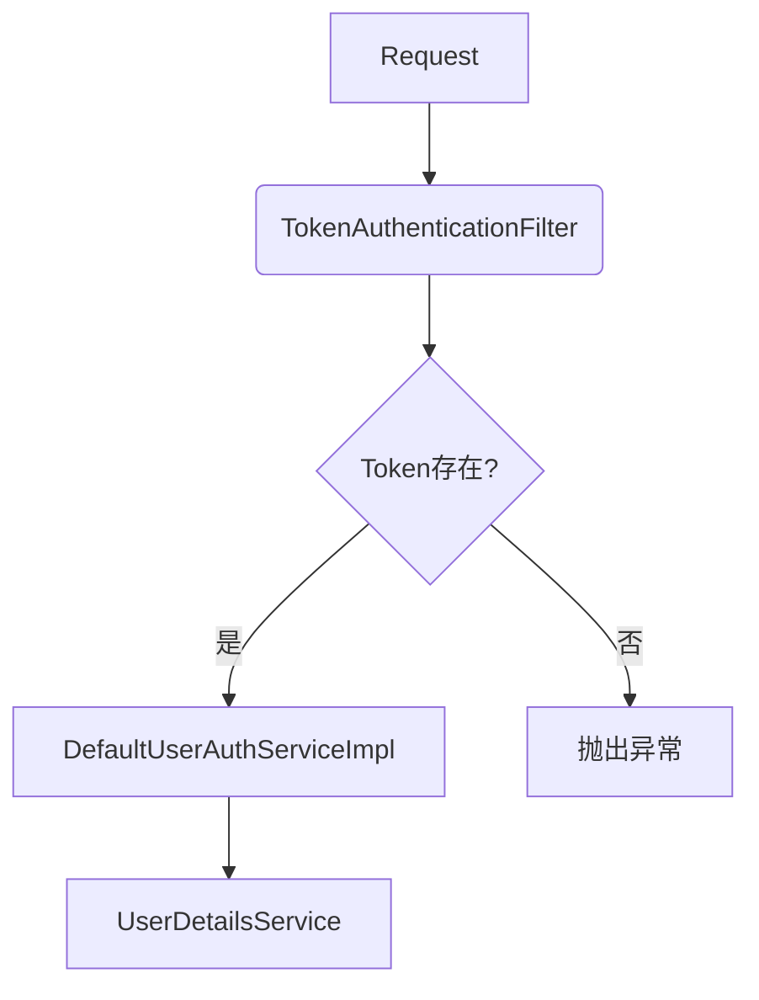

# Web 模块文档

## 1. 模块概述

本模块为系统Web层核心组件，提供以下核心功能：

- 基础控制器支持（BaseController）
- 安全认证体系（JWT/OAuth2兼容扩展）
- 统一响应处理（AjaxResult+构建器模式）
- 异常统一处理（AuthExceptionHandler）
- 配置化管理（WebProperty/WebAuthProperty）

## 2. 目录结构

```
com.tbs.web 
├── config # 配置类 
├── enums # 枚举定义 
├── exception # 异常体系 
├── result # 响应结果处理 
├── security #安全认证模块 
├── uitl # 工具类 
└── BaseController.java # 基础控制器
```

## 3. 核心功能说明

### 3.1 安全认证体系

- **认证流程**



- **令牌管理**
    - 支持四种令牌来源（Header/Cookie/Param/Body）
    - 可配置过期时间（默认3600s）
    - 自动刷新机制（DateUtil.offset维护有效期）

### 3.2 响应处理

- **响应结构**

```json 
{
  "code": 200,
  "message": "操作成功",
  "data": {}
}
```
- **构建器模式**
```java
AjaxUtil.getInstance().success("查询成功", data).appendField("total", 100);
```
### 3.3 异常处理
| 异常类型              | 错误码 | 说明                   |
|-----------------------|--------|------------------------|
| InvalidTokenException | 401    | 令牌无效或过期         |
| NotFoundTokenException| 401    | 未找到令牌             |
| SimpleAuthException   | 403    | 权限不足               |

## 4. 配置说明

### 4.1 application.yml 示例
```yaml
tbs:
  web:
    enable-cors:
      true enable-form-login:
        false secured-paths:
          /api/** permit-all-paths:
            /,/login auth:
              enable:
                true token-source:
                  header token-field-name: Authorization
```
### 4.2 配置类说明
- **WebProperty**：基础Web配置
  - CORS/CSRF控制
  - 路径权限配置
  - 响应构建器选择

- **WebAuthProperty**：安全相关配置
  - 令牌生命周期管理
  - 认证实现类动态加载

## 5. 使用示例

### 5.1 创建控制器
```java

@RestController
@RequestMapping("/api/user")
public class UserController extends BaseController {
  @GetMapping("/{id}")
  public AjaxResult getUser() {
    return AjaxUtil.getInstance().success(userService.findById(getCurrentUserId()));
  }
}
```
### 5.2 自定义响应
```java
AjaxUtil.getInstance().custom(200,"自定义消息",data).appendField("metadata",metaInfo);
```
## 6. 依赖关系
- **模块依赖**
  - common：基础工具/异常类
  - app：用户认证业务实现

- **第三方依赖**
  - Spring Security（认证授权）
  - FastJSON2（序列化）
  - Hutool（日期处理）
